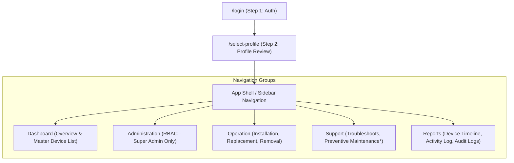

# DESIGN BRIEF: MH02 ASSET REPORT PORTAL
*Fleet Safety & Telematics Management UI/UX Architecture*

> **Status Dokumen**: Acuan Desain Arsitektur Antarmuka & Usulan Desain (Menunggu Peninjauan)  
> **Tanggal**: 15 Oktober 2026  
> **Basis Kebutuhan**: `ALUR WEB MH02.md`, `Catatan Project MH02.md`, `PRODUCT.md`, dan Klarifikasi Pak Tama (15 Okt 2026).

---

## 1. Information Architecture (IA) & Navigasi

Sistem navigasi dirancang dengan struktur hirarkis yang mencerminkan alur operasional lapangan dan pengawasan manajerial:

### A. Rincian Rute & Halaman
1. **Autentikasi (2-Step)**:
   - `/login`: Form Username & Password.
   - `/select-profile`: Tampilan konfirmasi profil pengguna (Username, Role, Distrik) dengan tombol *Continue* dan *Cancel*.
2. **Dashboard**:
   - `/dashboard`: 6 KPI cards, 4 visual charts, monthly activities summary, quick actions, dan tabel filterable *Master Device List*.
3. **Administration (Khusus Superadmin)**:
   - `/administration/users`: Tabel RBAC, modal tambah user, modal edit user, dan dialog konfirmasi hapus.
4. **Operation**:
   - `/operations/installation`: Tabel records, tombol New Form, tombol export CSV.
   - `/operations/installation/new`: Formulir instalasi baru (kalkulasi durasi otomatis, slot 4 foto).
   - `/operations/installation/[id]`: Detail instalasi (kartu data, kartu foto dengan modal zoom, tombol aksi navigasi).
   - `/operations/replacement`: Tabel records, New Form, dan Detail View (komparasi unit lama vs baru).
   - `/operations/removal`: Tabel records, New Form, dan Detail Action (popup modal info unit).
5. **Support**:
   - `/support/troubleshoots`: Tabel records, New Form (8 tipe alat, foto sebelum/sesudah), dan History Breakdown per komponen.
   - `/support/preventive-maintenance`: *Placeholder layout* dengan label transparan menunggu spesifikasi 19 item Health Check resmi.
6. **Reports & Traceability**:
   - `/reports/activity-log`: Tabel agregat seluruh aktivitas perangkat lintas distrik.
   - `/reports/timeline/[id]`: Kronologi siklus hidup tunggal per perangkat (statistik aktivitas & riwayat event).
   - `/reports/audit-logs`: Tabel mutasi data sistem dengan deep-link interaktif ke entitas terkait.

---

## 2. Layout, Grid & Framing Antarmuka

### A. App Shell Structure
- **Persistent Sidebar (Kiri)**:
  - Lebar: 260px (desktop) dengan mode collapsible untuk layar laptop/tablet.
  - Header: Identitas produk (*MH02 Asset Report*).
  - Profil Pengguna: Avatar, Nama, NRP, Distrik, badge Role, serta tombol Logout.
  - Menu Items: Pengelompokan logis dengan ikon SVG yang jelas dan penanda rute aktif (*active state indicator*).
  - *Demo Tool Container*: Banner toggle `[DEMO ONLY: Switch Active Role]` di bagian bawah sidebar untuk keperluan pengujian UI.
- **Top Bar (Atas)**:
  - Breadcrumbs navigasi dinamis (misal: `Operation > Installation > New Form`).
  - Indikator Distrik aktif & tanggal operasional.
- **Main Content Area (Tengah-Kanan)**:
  - Lebar fleksibel dengan padding konsisten (`p-6` atau `p-8`).
  - Container responsif dengan batasan lebar maksimal konten agar tetap scannable pada monitor ultra-wide.

---

## 3. Hierarki Visual & Prinsip Keterbacaan Lapangan

Aplikasi digunakan oleh teknisi lapangan (workstation/tablet) hingga manajemen di Head Office:
1. **Scannability First**:
   - Metrik utama (angka KPI dan status badge) harus dapat dikenali dalam 1-2 detik.
   - Angka statistik ditampilkan dengan ukuran teks besar (font-semibold/bold, 24px-32px) dengan label penjelasan yang ringkas.
2. **Status Badge System**:
   - Setiap kondisi perangkat memiliki badge visual yang membedakan kondisi fisik secara tegas:
     - `In Use`: Menandakan perangkat sedang aktif terpasang pada unit armada.
     - `In Stock - RFU`: Siap digunakan untuk instalasi/pergantian.
     - `In Stock - Damaged`: Menandakan unit rusak di gudang site.
     - `In Stock - Butuh Repair ke HO`: Usulan label UI untuk perangkat In Stock kondisi butuh repair dan dikirim ke HO (bukan nama field database resmi).
     - `HO Repair`: Keterangan perangkat dalam penanganan teknis Head Office.
3. **Form Clarity**:
   - Label formulir diletakkan di atas input field untuk memudahkan pengisian pada layar sentuh/tablet.
   - Nilai kalkulasi otomatis (seperti *Durasi Kerja*) diberi latar belakang visual khusus (read-only/highlighted) agar teknisi tahu bahwa sistem menghitungnya secara instan.

---

## 4. Spesifikasi Komponen Utama

### A. Tabel Data Interaktif (Universal Table Standard)
Setiap modul tabel (`Device List`, `Installation`, `Replacement`, `Removal`, `Troubleshoot`, `User Management`, `Audit Logs`, `Activity Log`) menerapkan standar:
- **Search Bar Universal**: Pencarian cepat berbasis teks (Device ID, Unit No, Form No, Pelaksana).
- **Faceted Column Filter**: Popover filter independen per kolom (tipe checkbox/dropdown per kolom seperti sistem belanja online).
- **Clear Filter Button**: Tombol satu-klik untuk mereset seluruh filter aktif kembali ke default.
- **Pagination & Show Rows**: Kontrol jumlah baris per halaman (10, 25, 50, 100) dan navigasi halaman.
- **Export to CSV**: Tombol aksi ekspor dengan popover filter *Date Range* (Tanggal Mulai s.d. Tanggal Selesai).

### B. Formulir Operasional & Slot Upload Foto
- **Field Durasi Otomatis**: Input jam mulai dan jam selesai menghitung selisih waktu secara otomatis tanpa reload.
- **Slot Upload Foto Terdedikasi**:
  - Disediakan area drag-and-drop / file selector terpisah untuk masing-masing sudut foto yang diwajibkan dokumen.
  - Menampilkan thumbnail pratinjau setelah file dipilih, nama file, dan tombol ganti/hapus.
- **Modal Lightbox / Zoom Foto**:
  - Pada halaman detail, thumbnail foto ditampilkan dalam kartu.
  - Mengklik thumbnail akan membuka modal popup beresolusi penuh dengan tombol tutup dan zoom.

### C. Komponen Visual Timeline
- Alur vertikal dengan penanda waktu (*timestamp*), ikon pembeda event (Audit vs Operasional biasa), badge skor *Health Check*, dan nama pelaksana (teknisi/operator).

---

## 5. Usulan Konsep Visual & Tema Warna *(Untuk Ditinjau)*

> [!NOTE]
> Bagian ini merupakan **usulan konsep desain** untuk menjaga estetika industrial yang bersih dan profesional. Konsep ini terbuka untuk masukan dan tidak akan dikunci sebelum disetujui.

### A. Palet Warna yang Diusulkan
- **Neutral / Background**:
  - Workspace Background: `Slate 50` / `Zinc 100` (terang, bersih, kontras tinggi).
  - Card & Container: Murni `White` (`#FFFFFF`) dengan border halus (`Slate 200`).
  - Teks Utama: `Slate 900` (`#0F172A`) untuk keterbacaan maksimum.
  - Teks Sekunder: `Slate 500` / `Slate 600`.
- **Primary / Brand Accent**:
  - Deep Industrial Blue (`#1E40AF` / `#0369A1`): Memberikan kesan kokoh, presisi teknis, dan reliabilitas armada telematika.
- **Status Semantic Accent**:
  - Success / Active / RFU: `Emerald 600` (latar lembut `Emerald 50`).
  - Warning / In Stock / Antrean: `Amber 600` (latar lembut `Amber 50`).
  - Danger / Damaged / Critical: `Rose 600` (latar lembut `Rose 50`).
  - Info / HO Repair / Processing: `Indigo 600` (latar lembut `Indigo 50`).

### B. Tipografi yang Diusulkan
- Font Family: Sans-serif modern dan netral seperti **Inter** atau **Plus Jakarta Sans** untuk ketajaman angka numerik dan kode serial perangkat.

---

## 6. Kebutuhan Responsif & Aksesibilitas

### A. Adaptasi Layar (Responsive Breakpoints)
- **Desktop (≥ 1280px)**: Sidebar penuh (260px), multi-column form (2-3 kolom), grid statistik 4-6 kartu sejajar.
- **Laptop / Standard Workstation (1024px - 1279px)**: Grid statistik menyesuaikan 2-3 kolom per baris, tabel dengan scroll horizontal yang mulus tanpa merusak tata letak.
- **Tablet / Field Touchscreen (768px - 1023px)**: Sidebar beralih ke mode slide-over / collapsed drawer, form input beralih ke single-column untuk kemudahan sentuhan jari.

### B. Prinsip Aksesibilitas (A11y)
- Kontras warna teks terhadap latar belakang memenuhi standar **WCAG AA** (minimal 4.5:1 untuk teks normal).
- Seluruh elemen interaktif (tombol, dropdown, field input, pagination) memiliki indikator fokus keyboard (`focus-visible`) yang tegas.
- Form controls menggunakan elemen label HTML yang terhubung secara semantik (`htmlFor`).

