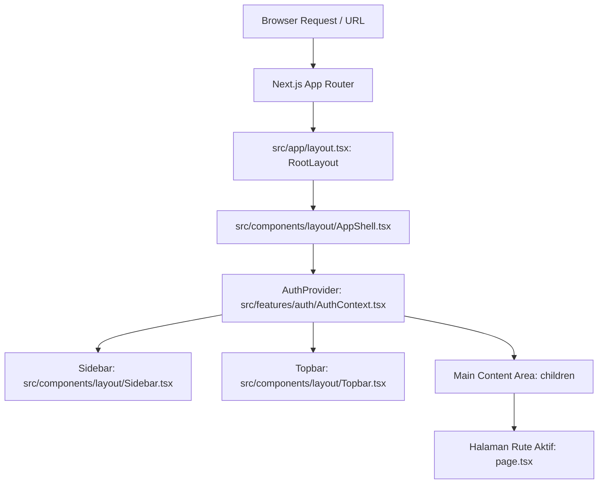

# Arsitektur Proyek MH02 Asset Report

Dokumen ini menjelaskan arsitektur perangkat lunak, aliran render aplikasi, mekanisme manajemen state lokal, serta status kesiapan fitur pada sistem **MH02 Asset Report Portal** per **16 Oktober 2026**.

---

## 1. Aliran Render Aplikasi (App Router Lifecycle)

Aplikasi dibangun menggunakan arsitektur **Next.js 15 App Router** dengan mode rendering *Client Component* untuk memfasilitasi interaktivitas prototipe lokal:



### Rincian Eksekusi Setiap Lapisan:
1. **Inisialisasi Dokumen (`src/app/layout.tsx`)**:
   - Berkas ini bertindak sebagai kerangka HTML dasar (`<html>` dan `<body>`).
   - Memuat berkas `src/app/globals.css` yang berisi stylesheet global, font Inter, dan variabel warna.
   - Membungkus seluruh halaman dengan `<AppShell>{children}</AppShell>`.

2. **Kerangka Antarmuka (`src/components/layout/AppShell.tsx`)**:
   - Dinyatakan sebagai `"use client"`.
   - Menginisialisasi `AuthProvider` yang mengelilingi seluruh struktur tata letak (Sidebar, Topbar, dan Konten Utama).
   - Mengatur pembagian grid layout layar: Sidebar di sisi kiri (lebar responsif) dan area kerja di sisi kanan dengan overflow vertikal independen.

3. **Komponen Pembantu Navigasi (`Sidebar.tsx` & `Topbar.tsx`)**:
   - Mengonsumsi status pengguna (`currentUser`), fungsi penggantian peran (`switchRole`), dan status ciut/rentang (`isSidebarOpen`, `toggleSidebar`) dari `AuthContext`.
   - Menghitung breadcrumb rute aktif secara dinamis di `Topbar.tsx` berdasarkan URL pathname Next.js (`usePathname()`).

---

## 2. Keterhubungan Komponen, State Autentikasi, dan Navigasi

Hubungan ketergantungan antara komponen navigasi, konfigurasi menu, dan state autentikasi disusun secara terpusat:

```text
[src/types/navigation.ts]
      │  (Mendefinisikan tipe UserRole, UserProfile, NavigationGroup)
      ▼
[src/data/navigation.ts] ◄── [Konfigurasi Rute Menu, Ikon Lucide, & requiredRole]
      │
      ▼
[src/components/layout/Sidebar.tsx] ◄── Mengonsumsi `useAuth()` & `navigationConfig`
      │
      ├── Memeriksa apakah `requiredRole` item sesuai dengan `currentUser.role`.
      ├── Mengaktifkan styling tombol menu berdasarkan kecocokan `usePathname()`.
      └── Menyediakan antarmuka interaktif `[DEMO ONLY] Role Switcher`.
```

### Mekanisme Role-Based Access Control (RBAC) pada Prototipe:
- Konfigurasi menu di `src/data/navigation.ts` menyertakan atribut opsional `requiredRole: "superadmin"`.
- Grup menu **Administration** (User Management) memiliki filter peran:
  ```typescript
  if (group.requiredRole && group.requiredRole !== currentUser.role) {
    return null; // Menu disembunyikan sepenuhnya dari pandangan Teknisi/User
  }
  ```
- Proteksi Tingkat Halaman: Pada `src/app/administration/users/page.tsx`, terdapat guard eksplisit: jika `currentUser.role !== "superadmin"`, sistem me-render layar peringatan *"Akses Ditolak"* alih-alih menampilkan formulir manajemen pengguna.

---

## 3. Cara Kerja Role Switcher Demo

Fitur peralihan peran (`[DEMO ONLY] Role Switcher`) dirancang khusus untuk mempermudah evaluasi hak akses UI tanpa memerlukan otentikasi backend nyata:

1. **State Terpusat (`src/features/auth/AuthContext.tsx`)**:
   - Mengelola state `currentUser: UserProfile` dengan nilai bawaan:
     - Nama: `"Budi Santoso (Admin HO)"`
     - NRP: `"NRP-884920"`
     - District: `"Sangatta"`
     - Role: `"superadmin"`
2. **Fungsi `switchRole(role)`**:
   - Saat tombol **Teknisi / User** diklik, fungsi mengubah profil menjadi:
     - Nama: `"Ahmad Rizki (Teknisi)"`
     - NRP: `"NRP-772104"`
     - Role: `"user"`
   - Perubahan ini memicu re-render reaktif instan di seluruh aplikasi:
     - Menu `Administration` di sidebar langsung hilang.
     - Badge profil di sidebar berubah dari lencana emas (*Superadmin*) ke biru (*Teknisi*).
     - Jika pengguna sedang berada di halaman `/administration/users`, layar langsung berganti menjadi tampilan proteksi *"Akses Ditolak"*.

---

## 4. Matriks Status Kesiapan Fitur Aplikasi

Sesuai dengan prinsip transparansi teknis, berikut adalah klasifikasi status modul aplikasi saat ini:

| Modul / Fitur | Rute URL | Status Aktual | Deskripsi Kesiapan |
| :--- | :--- | :--- | :--- |
| **App Shell & Layout** | Seluruh rute | **SUDAH BERJALAN** | Tata letak dasar, sidebar collapse/expand, breadcrumb dinamis, dan header responsif telah beroperasi penuh. |
| **Role Switcher Demo** | Sidebar | **SUDAH BERJALAN** | Simulasi pergantian role Superadmin vs User/Teknisi berjalan reaktif berbasis React Context. |
| **Proteksi RBAC Menu** | `/administration/*` | **SUDAH BERJALAN** | Menu disaring dari sidebar dan halaman dilindungi guard role. |
| **Halaman 404** | Rute invalid | **SUDAH BERJALAN** | Layanan fallback 404 interaktif dengan tombol kembali ke dashboard. |
| **Dashboard Utama** | `/` | **SIMULASI (Placeholder)** | Menampilkan ringkasan status fondasi dan kartu pintasan rute. Widget KPI dan grafik belum terpasang. |
| **User Management** | `/administration/users` | **SIMULASI (Placeholder)** | Memiliki guard RBAC Superadmin, namun tabel/form manajemen akun pengguna belum dibuat. |
| **Installation Form & Table** | `/operations/installation` | **BELUM DIBUAT (Draf)** | Rute dan wadah tampilan tersedia, form instalasi & tabel riwayat belum diimplementasikan. |
| **Replacement Form & Table** | `/operations/replacement` | **BELUM DIBUAT (Draf)** | Rute dan wadah tampilan tersedia, form pertukaran SN & tabel belum diimplementasikan. |
| **Removal Form & Table** | `/operations/removal` | **BELUM DIBUAT (Draf)** | Rute dan wadah tampilan tersedia, form pelepasan aset belum diimplementasikan. |
| **Troubleshoots Form & Table** | `/support/troubleshoots` | **BELUM DIBUAT (Draf)** | Rute dan wadah tampilan tersedia, form tiket gangguan & tabel belum diimplementasikan. |
| **Preventive Maintenance** | `/support/preventive-maintenance` | **BELUM DIBUAT (Draf)** | Berlabel eksplisit "Pending 19/19". Menunggu spesifikasi resmi 19 item inspeksi. |
| **Device Activity Log** | `/reports/activity-log` | **BELUM DIBUAT (Draf)** | Rute dan wadah tampilan tersedia, tabel log aktivitas armada belum dibuat. |
| **Device Timeline** | `/reports/timeline` | **BELUM DIBUAT (Draf)** | Rute dan wadah tampilan tersedia, visualisasi siklus hidup aset belum dibuat. |
| **Audit Logs** | `/reports/audit-logs` | **BELUM DIBUAT (Draf)** | Rute dan wadah tampilan tersedia, tabel audit perubahan data belum dibuat. |
| **Alur Login 2-Tahap** | `/login` | **BELUM DIBUAT** | Rute `/login` belum memiliki berkas `page.tsx` khusus (saat ini jatuh ke penanganan 404). |
