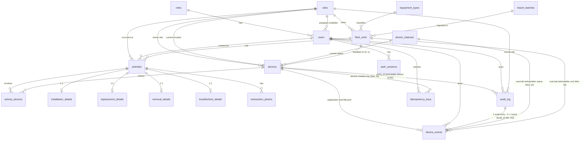

# MH02 — Phase 2: Database & API Design (DRAFT FOR REVIEW)

Status: **FINAL design baseline (Revision 11)**. No SQL has been executed and no table exists in `db_asset_report`.
Revision 11 FINAL changes: (1) **every former pending item is decided** (P1–P7, Q1, Q2, Q5, Q11–Q18); where the business had not answered, the safest default was chosen and is recorded as an assumption in §10 with its impact if it changes, so no decision is left open; (2) the Revision 10 schema additions are now **implemented in the migration drafts** (V003 `idempotency_keys.device_id`, V005 `audit_log.action`/`reason`, V006 `device_events` override columns and CHECKs, all in place because nothing was ever executed); (3) the migration runner (`database/scripts/db-migrate.mjs`) and the reference and dev seeds exist as drafts (§8); (4) §10 is rewritten as the final decision and assumption register. The revision notes below this line (Revision 10 and older) are **history**; where they say "pending" or "proposed", §10 of this revision supersedes them. Nothing has been executed against any database.
Revision 10 changes (business decisions; **V001–V007 are unchanged and no migration was created or changed**): (1) a Super Admin may **override a device's status and Unit directly**, without a transaction, with a **mandatory reason**; it is recorded as a `device_override` device event plus an audit row with before/after values (§3.18, §6); (2) **every Super Admin change, however small, is audited** in the same SQL transaction, with new `action` and `reason` audit fields and an explicit coverage rule (§3.15); (3) **soft delete becomes the Device Archive**: history, audit and Timeline are kept, archiving is allowed even for a device with history, archived devices leave active lists, and only a Super Admin can view them (`GET /devices?archived=true`); there is no hard-delete endpoint (§3.8, §6, §7); (4) transaction deletion is re-confirmed and reconciled with overrides and archived devices (§6); (5) there is **no Site transfer feature**, `site_id` stays immutable through the API; (6) `in_stock_damaged` is kept, its UI label is **`In Stock (Repair)`**; (7) Save buttons are disabled with `Saving...`, and **idempotency keys now also protect `POST /devices`** (§3.19). Required schema additions are listed in §8 ("Migration impact of Revision 10"); new pending questions are Q11–Q18 (§10).
Revision 9 changes: (1) an `sp_getapplock` timeout or failure at creation step (0) is no longer treated as a race loss: it proves nothing, so the request reads nothing, concludes nothing, writes nothing and returns a bounded 503 `COMMIT_OUTCOME_UNKNOWN` (same key, staged files kept); the three signals (error 2627, applock timeout, ambiguous-COMMIT verification) are now defined separately; (2) a new periodic, bounded **committed-photo integrity check** driven by `transaction_photos` metadata detects "row exists but staging and final files are both gone", with defined behavior when the database or storage is unavailable; (3) a **cross-process per-photo lock** (`sp_getapplock` on `photo:{photo_id}`) serializes finalization, copy and orphan deletion, and stale `.copy` files are recovered under that lock. No tables or columns changed.
Revision 8 changes: (1) resolving an ambiguous COMMIT no longer relies on "a fresh connection": a per-key `sp_getapplock` barrier plus a `READCOMMITTEDLOCK` read makes the check correct with or without RCSI, and `503 TRANSACTION_NOT_COMMITTED` is returned only after the barrier proves the original transaction ended; anything uncertain stays `503 COMMIT_OUTCOME_UNKNOWN`; (2) a restart-safe photo staging and finalization mechanism (deterministic paths from `photo_id`, startup/periodic reconciler, orphan vs pending rules) with no new table or column; (3) §8A gains RCSI and crash/restart tests.
Revision 7 changes (supersedes the 503 rule of Revision 6): (1) idempotency keys are now **permanent** (no purge, no `expires_at`), so an "expired key treated as new" can no longer create a duplicate; a key missing after a duplicate-key error is an integrity incident that returns a terminal 409 `IDEMPOTENCY_OUTCOME_UNKNOWN` instead of 503, and no retry with the same key is claimed safe; `DELETE` is no longer granted on `idempotency_keys` and P7 is re-scoped; (2) §3.19 and §8A now distinguish a COMMIT that definitely failed (rollback) from an **ambiguous commit** (connection lost during/after COMMIT), resolved by re-reading the key with the same idempotency key, and the Phase 6 tests cover both outcomes.
Revision 6 changes: (1) a missing key on the fresh read after a duplicate-key error now returns 503 and never re-runs the creation (a deleted key could otherwise be re-inserted and create a second transaction); (2) frontend idempotency scope is limited to new-transaction forms (PATCH keeps `row_version`); (3) new §8A states the Phase 6 tests that verify the nullable-column invariant.
Revision 5 changes: (1) `idempotency_keys.activity_id`/`form_number` are nullable while the transaction is uncommitted and must be populated before COMMIT (explicit invariant and verification); (2) the `transaction_deleted` CHECK now covers all six `source_*` columns; (3) concurrent duplicate-key handling is explicit (roll back the loser, then a fresh read for replay/hash comparison); (4) the app login's permissions on `idempotency_keys` are documented (SELECT, INSERT, UPDATE, DELETE), with `audit_log`/`device_events` still append-only.
Revision 4 changes: (1) deleting a transaction writes a `transaction_deleted` event per affected device (`event_type` widened to `VARCHAR(30)`), so deletions stay visible on the Device Timeline; (2) new `idempotency_keys` table and `Idempotency-Key` header stop repeated submissions from creating duplicate transactions; (3) the backend always derives UTC offsets from the transaction Site's zone (never from the client), with separate start/finish offset snapshots and an immutable zone snapshot.
Revision 3 changes: (1) the transaction `status` column and every `completed`/`in_progress` reference are removed (device statuses are untouched); (2) a per-Site time zone strategy replaces the "site-local wall-clock" assumption: transaction times are stored as UTC instants with a snapshot of the Site's zone; (3) `device_events`/`audit_log` hardened: one audit entry per event, same-transaction writes, defense-in-depth against UPDATE/DELETE, no duplicate Timeline entries.
Revision 2 (kept): `started_at`/`finished_at`; device access by owning Site only; complete before/after snapshots; explicit registration event; new devices always `in_stock_rfu`. (In Revision 11 every item that was marked PENDING is decided; see §10.)
Target: SQL Server (tested engine: 2025 Developer), driver `mssql`, parameterized SQL, SQL transactions.
Seed data in this design is **fictional development data only**.

Conventions: `UUID` = `UNIQUEIDENTIFIER` (default `NEWSEQUENTIALID()`); **every stored timestamp is a UTC instant** (`DATETIME2`, default `SYSUTCDATETIME()`), including `started_at`/`finished_at`; the Site's local time is derived from a time zone recorded per Site and snapshotted per activity (§3.9, "Time zone strategy"); lookups use small `INT` keys; all names are `snake_case`.

---

## 1. ERD



Design idea: **one `activities` header table** (what the Activity Log shows) with 1:1 detail tables per type, plus **`activity_devices`** linking each activity to every device it touches (Replacement touches two). Device Timeline, Activity Log and Dashboard all read from these same tables, so they cannot disagree. The **Audit Log** is a separate, append-only table of data changes, so operational activity and data modification stay distinct. A small **`device_events`** table records lifecycle events that are not field activities (above all the **registration** of a device), keyed by the immutable `device_id`. The Device Timeline is the chronological union of `device_events` and `activity_devices`⋈`activities`.

---

## 2. Table list

| # | Table | Purpose | Phase |
|---|---|---|---|
| 1 | `schema_migrations` | Applied migration versions + checksums | DB |
| 2 | `sites` | Districts / locations (Head Office configurable) with per-Site time zone | DB |
| 3 | `roles` | `superadmin`, `user` | DB |
| 4 | `users` | Accounts, role, assigned site | DB |
| 5 | `auth_sessions` | Server-side sessions (hashed token) | **Auth phase** |
| 6 | `equipment_types` | Dump Truck, Water Truck, Fuel Truck, Loader, Others | DB |
| 7 | `device_statuses` | in_use / in_stock_rfu / in_stock_damaged / in_stock_ho (UI label of `in_stock_damaged`: In Stock (Repair)) | DB |
| 8 | `fleet_units` | Unit No ↔ equipment type ↔ EGI ↔ site | DB |
| 9 | `devices` | Master Device (central identity) | DB |
| 10 | `activities` | Header for all 4 transaction types | DB |
| 11 | `activity_devices` | Device ↔ activity link with before/after state | DB |
| 12 | `installation_details` | Installation-only fields | DB |
| 13 | `replacement_details` | Replacement-only fields | DB |
| 14 | `removal_details` | Removal-only fields | DB |
| 15 | `troubleshoot_details` | Troubleshoot-only fields | DB |
| 16 | `transaction_photos` | Photo metadata + storage path | DB |
| 17 | `lookup_values` | Shift, source power, SPM version, area, group leader | DB |
| 18 | `form_sequences` | Race-free form numbers (`INS-202610-001`) | DB |
| 19 | `audit_log` | Append-only data-change log (every application write; reason and action added in Rev 10) | DB |
| 20 | `import_batches` | Provenance for fleet/device imports | DB |
| 21 | `device_events` | Append-only device lifecycle events (registration, details updated, archived/soft-deleted, transaction deleted, device override) for the Timeline | DB |
| 22 | `idempotency_keys` | Duplicate-submission protection for transaction creation and device registration | DB |

---

## 3. Data dictionary

`PK` primary key, `FK` foreign key, `UQ` unique, `NN` not null. Everything not marked NN is nullable.

### 3.1 `sites`
| Column | Type | Notes |
|---|---|---|
| site_id | INT IDENTITY | PK |
| site_code | NVARCHAR(30) | NN, UQ (e.g. `SANGATTA`) |
| name | NVARCHAR(100) | NN |
| time_zone_id | VARCHAR(50) | NN. IANA zone of the Site. Allowed values come from a configurable Indonesian list (`Asia/Jakarta` and `Asia/Pontianak` = WIB, `Asia/Makassar` = WITA, `Asia/Jayapura` = WIT); there is **no default** and **no assumption that Sites share a zone**. Real values per Site are entered at production setup (decision P6, §10); dev seed values are unverified placeholders |
| is_operating_district | BIT | NN, default 1. **Head Office = 0, configurable**; not hard-coded anywhere in code |
| is_active | BIT | NN, default 1 |

### 3.2 `roles`
| role_id INT PK | role_code NVARCHAR(30) NN UQ (`superadmin`,`user`) | name NVARCHAR(60) NN |

### 3.3 `users`
| Column | Type | Notes |
|---|---|---|
| user_id | UUID | PK |
| nrp | NVARCHAR(30) | NN, UQ — login identifier |
| name | NVARCHAR(120) | NN |
| email, phone | NVARCHAR(150/30) | |
| role_id | INT | NN, FK → roles |
| site_id | INT | FK → sites. **Required for role `user`** (service rule); optional for `superadmin` (global role, independent of Site) |
| password_hash | NVARCHAR(255) | NN. argon2id or bcrypt; never plaintext |
| status | VARCHAR(10) | NN, CHECK in (`active`,`inactive`) |
| failed_login_count / locked_until | INT / DATETIME2 | brute-force lockout |
| last_login_at | DATETIME2 | |
| data_source | VARCHAR(20) | NN, `app` or `dev_seed`. App refuses to start in production if any `dev_seed` user exists |
| created_at, created_by, updated_at, updated_by | | audit columns |

A user cannot change their own `site_id` or `role_id` (no such endpoint for self).

### 3.4 `auth_sessions` *(auth phase)*
session_id UUID PK · token_hash CHAR(64) NN UQ (SHA-256 of the cookie token) · user_id FK NN · created_at · expires_at NN · revoked_at · ip_address · user_agent.
Role and Site are **always read from `users` per request**, never stored in the cookie.

### 3.5 `equipment_types`
equipment_type_id INT PK · name NVARCHAR(40) NN UQ.

### 3.6 `device_statuses`
| status_id | code (UQ) | UI label | is_in_stock |
|---|---|---|---|
| 1 | `in_use` | In Use | 0 |
| 2 | `in_stock_rfu` | In Stock RFU | 1 |
| 3 | `in_stock_damaged` | In Stock (Repair) | 1 |
| 4 | `in_stock_ho` | In Stock HO | 1 |

Codes keep the frontend's existing values. **Decision (Revision 10):** the code `in_stock_damaged` is kept unchanged; only its UI label reads **"In Stock (Repair)"**. No other status code or label changes.

### 3.7 `fleet_units`
| Column | Type | Notes |
|---|---|---|
| unit_id | UUID | PK |
| unit_no | NVARCHAR(30) | NN, UQ globally. **Decision P1 (Rev 11): globally unique** (`UQ_fleet_units_unit_no`) |
| equipment_type_id | INT | NN, FK |
| egi | NVARCHAR(60) | model code |
| is_egi_confirmed | BIT | NN, default 0 (matches `isConfirmedEgi`) |
| site_id | INT | NN, FK |
| is_active | BIT | NN, default 1 |
| data_source | VARCHAR(20) | NN: `dev_seed` / `import` / `manual` |
| import_batch_id | UUID | FK → import_batches |

### 3.8 `devices` (Master Device)
| Column | Type | Notes |
|---|---|---|
| device_id | UUID | **PK, internal, never shown as a business key** |
| device_code | NVARCHAR(40) | NN, **UQ** — business identifier (today's `D001`) |
| serial_number | NVARCHAR(80) | NN, filtered UQ (non-deleted) |
| status_id | INT | NN, FK → device_statuses |
| site_id | INT | NN, FK → sites — **ownership / official allocation Site** (today's `district`). **The only column used for access control.** Set at registration, **immutable through the API**. **There is no Site transfer feature and no transfer endpoint** (Revision 10 decision); the rule is enforced in the service (a database trigger would be optional extra hardening and is not designed) |
| current_location_site_id | INT | FK → sites — **informational physical location** (today's `currentLocation`). Defaults to `site_id` at registration. **Never grants access**; a device located at a Site but owned by another Site stays invisible to that Site's users. Changed only by transactions (§6) |
| current_unit_id | UUID | FK → fleet_units; set only while `in_use` |
| health_check_status | VARCHAR(15) | NN, CHECK in (`complete`,`incomplete`,`not_checked`), default `not_checked` |
| last_maintenance_date | DATE | |
| notes | NVARCHAR(500) | |
| data_source | VARCHAR(20) | NN `dev_seed` / `import` / `manual` |
| import_batch_id | UUID | FK |
| is_deleted / deleted_at / deleted_by | BIT/…| **Device Archive** (soft delete): the device row and all its history are kept; archived devices are excluded from active lists (see "Archive and override" below). An archive writes an audit row and a `soft_deleted` row to `device_events` |
| row_version | ROWVERSION | optimistic concurrency |
| created_at, created_by, updated_at, updated_by | | |

Constraints:
- `CHECK ((status_id = 1 AND current_unit_id IS NOT NULL) OR (status_id <> 1 AND current_unit_id IS NULL))`: In Use ⇔ has a unit.
- Filtered `UNIQUE (current_unit_id) WHERE current_unit_id IS NOT NULL`: one device per unit. **Decision P2 (Rev 11): one device per unit**, enforced by this index (`UX_devices_current_unit_id`).
- `status_id` of a newly inserted device must be `2` (`in_stock_rfu`); enforced in the service and by the registration procedure, not by a default alone.
- Equipment type and EGI are **derived** from `current_unit_id → fleet_units`, not stored. This matches the frontend, where they are null while in stock.

**Archive and override (Revision 10).**
- **Archive = soft delete.** `is_deleted = 1`, `deleted_at`, `deleted_by`. No row is ever removed, so `activity_devices`, `device_events`, `audit_log` and photos keep pointing at the device and its full history stays readable. Active lists, dropdowns and write validations use `is_deleted = 0`; the Super Admin **Device Archive** uses `is_deleted = 1`. `device_code` stays reserved forever (its unique constraint covers archived devices); a serial number of an archived device may be reused, because its filtered unique index covers non-deleted devices only. **Hard delete is not used for archiving.** Decided (Rev 11): there is **no restore** (Q12), **no hard delete** through the application (Q15), an **`in_use` device cannot be archived** (Q17), and archived devices are **excluded from Dashboard aggregates** while their history stays visible (Q13).
- **Override.** A Super Admin may change `status_id` and `current_unit_id` directly, as an audited action that is **not a transaction** (no `activities` row), with a **mandatory reason** (§6). The CHECK above still applies, so the pair must stay consistent: `in_use` requires a Unit, every stock status clears it. An override does **not** touch `current_location_site_id`, `last_maintenance_date` or `health_check_status` (decision Q16).

### 3.9 `activities` (header; this is the Activity Log source)
| Column | Type | Notes |
|---|---|---|
| activity_id | UUID | PK |
| activity_type | VARCHAR(15) | NN, CHECK in (`installation`,`replacement`,`removal`,`troubleshoot`) |
| form_number | NVARCHAR(30) | NN, UQ (`INS-202610-001`) |
| site_id | INT | NN, FK — **taken from the actor's Site (user) or validated selection (Super Admin)** |
| unit_id | UUID | FK → fleet_units |
| started_at | DATETIME2(0) | NN — **UTC instant** of the entered Start Date + Start Time |
| finished_at | DATETIME2(0) | NN — **UTC instant** of the entered Finish Date + Finish Time. `CHECK (finished_at >= started_at)`. Work is recorded only after it is finished, so a transaction cannot be saved without it |
| time_zone_id | VARCHAR(50) | NN — snapshot of `sites.time_zone_id` of the activity's Site at creation. Later changes to the Site's zone do not rewrite history |
| start_utc_offset_minutes / finish_utc_offset_minutes | SMALLINT | NN — snapshots of the zone's offset **at `started_at`** and **at `finished_at`** (e.g. +480 for WITA), each `CHECK BETWEEN -720 AND 840`. Always derived by the backend from `time_zone_id`; never supplied by a client. Two columns keep each local time exact even if a zone's offset changed between start and finish |
| started_at_local / finished_at_local | DATETIME2(0) | **Persisted computed** `DATEADD(MINUTE, start_utc_offset_minutes, started_at)` / `DATEADD(MINUTE, finish_utc_offset_minutes, finished_at)`. Used for local dates, month grouping, date-range filters and CSV export; indexable |
| duration_minutes | INT | NN. Computed server-side as `DATEDIFF(MINUTE, started_at, finished_at)`; `CHECK (duration_minutes = DATEDIFF(MINUTE, started_at, finished_at))` guards against drift. Correct for overnight and multi-day work because both ends are full instants; a client-sent duration is ignored |
| shift | VARCHAR(10) | `Shift 1`/`Shift 2` (not for troubleshoot/removal where absent today). Not a transaction status |
| technician_user_id | UUID | FK → users (creator). **Decision P3 (Rev 11): no**; the creator is always the technician, and a Super Admin cannot record a transaction on behalf of another technician |
| technician_name, technician_nrp | NVARCHAR | snapshot at creation |
| group_leader | NVARCHAR(120) | dropdown label only, **not an approval entity** |
| remarks | NVARCHAR(1000) | |
| created_at, created_by, updated_at, updated_by, row_version | | |

Indexes: (`site_id`, `started_at` DESC), (`activity_type`, `started_at`), (`started_at_local`).

**No transaction status.** `activities` has no `status` column. A form can only be saved after the work is finished, so every stored activity is finished by definition; there is no `completed`/`in_progress` state, no "Completed" badge and no transaction-status filter. (Device statuses `in_use`, `in_stock_rfu`, `in_stock_damaged`, `in_stock_ho` are a different concept and are unchanged.) Service-level rules: `startedAt` and `finishedAt` are required; `finishedAt >= startedAt`; `finishedAt` must not be later than the server's current time (small configurable clock-skew tolerance), since the work must already be done. This "not in the future" rule is enforced in the service, not in a CHECK, because it depends on the current time.

Date rules: `shift` is kept as entered and is **independent of the dates** (an overnight job may start in Shift 2 and end in Shift 1). Form-number month, Dashboard monthly grouping and list date filters use the **local month/date of `started_at_local`**. A device's `last_maintenance_date` uses the **local date of `finished_at_local`** (the day the work was completed, in the Site's zone). "Later activity" ordering (§6) uses (`started_at`, `created_at`), i.e. the real UTC instant, so it is correct across Sites in different zones. All forms must provide Start Date, Start Time, Finish Date and Finish Time.

#### Time zone strategy

Indonesia spans WIB, WITA and WIT and Sites may not share a zone, so nothing assumes one. The rules:

1. **Zone source.** Each Site has `sites.time_zone_id`. A transaction is always interpreted in the zone of **its own `activities.site_id`**, never the browser's zone, the server's zone or the user's own Site (Super Admin may record for any Site).
2. **Receiving.** The API accepts `startedAt`/`finishedAt` as **local wall-clock strings without offset** (`2026-10-20T22:30`). Strings containing `Z` or an offset are rejected (400) to avoid ambiguity. The backend resolves the Site's offset for that local time with the IANA zone, converts to UTC and stores the UTC instants plus the `time_zone_id` snapshot and the start/finish offset snapshots. Indonesia currently has no DST, but resolving through the zone and snapshotting the result keeps the design correct if that ever changes. A non-existent or ambiguous local time (DST gaps) is rejected. The conversion library choice (built-in `Intl` or a small tz library) is deferred to implementation; nothing is installed now.
3. **Storing.** UTC instants only. `duration_minutes` is computed from the UTC instants, so zone rules cannot distort it.
4. **Returning.** Responses give `startedAt`/`finishedAt` as ISO 8601 **with the activity's offset** (`2026-10-20T22:30:00+08:00`), plus `timeZone` (IANA id) and `timeZoneLabel` (`WIB`/`WITA`/`WIT`). System timestamps (`createdAt`, audit `occurredAt`, device `occurredAt`) are also returned with the offset of the **record's Site**.
5. **Displaying.** The frontend shows each row in **its own Site's local time with the zone label**, never converted to the viewer's browser zone. A Super Admin list that mixes Sites therefore shows e.g. "22:30 WITA" next to "21:30 WIB". Sorting is always by UTC instant.
6. **Editing.** Edits re-resolve local input using the activity's **snapshotted** `time_zone_id`, never the Site's current zone, and never a client value. Offsets are re-derived only for a time that actually changed; unchanged times keep their stored offset. `activities.site_id` and `time_zone_id` cannot be changed by an edit (the device/unit Site rules in §5 already tie the activity to one Site), enforced in the service and by an `AFTER UPDATE` trigger that rejects changes to either column. *Implementation note (static review, Revision 11):* SQL Server does not allow an `OUTPUT` clause without `INTO` on an `UPDATE` of a table that has an enabled UPDATE trigger, so the service must use `OUTPUT ... INTO @table` (or re-select `row_version`) when updating `activities`; `INSERT ... OUTPUT INSERTED.audit_id` on `audit_log` is unaffected because its triggers are for UPDATE/DELETE only. To be confirmed by the Phase 6 tests.
7. **Filtering and reporting.** Date-range filters, CSV date range and monthly grouping use `started_at_local` (the local date in each activity's own zone). A user-supplied date range is a pair of local dates.
8. **Changing a Site's zone** affects only future activities. Because this is a correction that rewrites meaning, it is a Super Admin action recorded in the Audit Log.
9. **The client never supplies an offset or zone.** The backend derives the offset only from the transaction Site's `time_zone_id` (taken from `activities.site_id`, which is itself derived from the actor's Site or the validated Super Admin selection). Request fields `timeZone`, `utcOffset`, `*_utc_offset_minutes` or any ISO value carrying `Z`/an offset are rejected (400), so a user cannot shift a transaction by lying about the offset.
10. **Historical stability.** `time_zone_id` and both offset snapshots are written once at creation and are never recomputed from the Site's current zone. Old transactions therefore keep displaying the same local times even if a Site's zone setting is corrected later.

### 3.10 `activity_devices`
| Column | Type | Notes |
|---|---|---|
| activity_id | UUID | PK part, FK, `ON DELETE CASCADE` |
| device_id | UUID | PK part, FK → devices |
| role | VARCHAR(10) | NN: `subject` (Installation/Removal/Troubleshoot), `old`, `new` (Replacement) |
| before_status_id / after_status_id | INT | NN, FK |
| before_unit_id / after_unit_id | UUID | FK (null when not installed) |
| before_location_site_id / after_location_site_id | INT | FK → sites |
| before_last_maintenance_date / after_last_maintenance_date | DATE | |

This replaces the frontend's `masterStateBefore` snapshot. It is the basis for safe rollback and also gives each device its own traceable history. Index on (`device_id`, `activity_id`) drives the Device Timeline.

**Snapshot completeness rule.** The four attributes above are **every device column that a transaction can change** (status, current unit, current location Site, last maintenance date). Both the before **and** after value is stored for each, so rollback can restore the *complete* previous device state, and a consistency check can verify that the device's current row still equals the `after_*` values of its latest activity before a revert is allowed. Columns that transactions never touch (`device_code`, `serial_number`, `site_id`, `health_check_status`, `notes`) are intentionally not snapshotted; they change only through Edit Device, which is audited. **Any future change that lets a transaction modify another device column must add its before/after pair in the same migration.** Every `activity_devices` row is written even when nothing changed (e.g. Troubleshoot: before = after), so each device's timeline stays complete.

**Overrides and snapshots (Revision 10).** A Super Admin override (§6) changes `status_id`/`current_unit_id` **without** creating an `activities` or `activity_devices` row, so existing snapshots are never edited or invalidated; they stay the immutable record of what each transaction saw and did. A **later** transaction snapshots the overridden state as its `before_*` (the state it actually found), so rolling that transaction back restores the overridden state, not an older one. For an **earlier** transaction, check 0 of the Edit/Delete rule (§6: the device's current row must equal that activity's `after_*`) now also detects an intervening override: if the override left the device in a different state, the edit/delete is refused with 409. The override itself is recorded as a `device_override` event (§3.18) and an audit row.

### 3.11 Detail tables (PK = FK = `activity_id`)
**`installation_details`**: equipment_type_id (snapshot), egi (snapshot), source_power, spm_version, area, location_detail, ip_address, ip_cpe, ip_vhms, notes.
**`replacement_details`**: old_final_status_id (NN, FK, must be in 2/3/4), source_power, spm_version, area, location_detail, ip_address, ip_cpe, ip_vhms. The old/new devices are rows in `activity_devices`. **Decision P5 (Rev 11): yes, the old and replacement devices always use the same Unit**: one `activities.unit_id` for both, and no `old_unit_id` column.
**`removal_details`**: reason (NN), reason_detail, final_status_id (NN, FK, must be in 2/3/4).
**`troubleshoot_details`**: component_type (`MH02 Device`,`GPS/Antenna`,`Camera`,`Wiring`,`Speaker`,`SPM`,`CPE`,`Firmware`), issue (NN), action_taken (NN), health_check_result (`Pass`/`Fail`/`Verified`/`Pending`).

### 3.12 `transaction_photos`
| Column | Type | Notes |
|---|---|---|
| photo_id | UUID | PK. **Generated by the service when the file is received, before the SQL transaction**, and supplied on insert (the default is not used); it deterministically names the file's staging path (see "Photo staging and crash recovery") |
| activity_id | UUID | NN, FK |
| slot_key | VARCHAR(40) | NN, e.g. `mh02_installed`; allowed values validated per activity type; UQ (`activity_id`,`slot_key`) |
| caption | NVARCHAR(200) | |
| storage_provider | VARCHAR(20) | NN, default `local_fs` (configurable) |
| storage_path | NVARCHAR(500) | NN, **relative** path under `PHOTO_STORAGE_ROOT`, never absolute. This is the **final** location, fixed when the file is received and written in the same transaction as the row: `photos/{yyyy}/{mm}/{photo_id}.{ext}` (UTC year/month of receipt, extension from the validated MIME type, never a client filename) |
| original_filename, mime_type, size_bytes, sha256 | | validated: jpeg/png/webp only; maximum size read from `PHOTO_MAX_BYTES`. **Decision P4 (Rev 11; configurable defaults, no schema impact):** `PHOTO_MAX_BYTES` = 10485760 (10 MB per photo); files of a deleted transaction stay in quarantine for `PHOTO_QUARANTINE_DAYS` = 90 days before removal |
| uploaded_by, uploaded_at | | |

Photo bytes never enter SQL Server. `PHOTO_STORAGE_ROOT` and `PHOTO_MAX_BYTES` are env settings; a storage adapter interface (`put/get/delete`) lets the company server swap in a share or object store later. Photos are served only through an authenticated route that re-checks Site.

#### Photo staging and crash recovery

Photos live in two places for a short time: a **staging** file before the transaction commits, and the **final** file afterwards. A crash can happen between "database committed" and "file moved", so the mapping must survive a restart. **No new table or column is needed**: the existing `transaction_photos` row already holds `photo_id`, the final `storage_path`, `sha256` and `size_bytes`, and the staging path is derived from `photo_id` alone.

**Deterministic mapping** (all transient files live only under `{PHOTO_STORAGE_ROOT}/_staging/`):
- `{photo_id}.part`: an upload in progress, never referenced by anything.
- `{photo_id}.upload`: a complete, validated upload (MIME type and magic bytes, size limit, `sha256` computed and fsynced), created by an atomic rename from `.part`.
- `{photo_id}.copy`: a temporary copy used only when the final location is on a different volume.
- Final file: the row's `storage_path`. So `photo_id` → staging path (by name) → final path (by row) is always recoverable.

**Order of operations (create):**
1. Receive each file, assign `photo_id`, stream to `.part`, validate, rename to `.upload`.
2. Run the creation SQL transaction (§3.19), inserting the `transaction_photos` rows (final `storage_path`, `sha256`, `size_bytes`) together with everything else.
3. Resolve COMMIT (definite, or via the barrier in §3.19 if ambiguous).
4. **Finalize** each photo (rules below) and respond.
5. If the request ended as a replay, or as a failure that was **verified** (not merely suspected), delete that request's `.upload` files now, because their `photo_id`s are referenced by no row. If the outcome is unresolved (`COMMIT_OUTCOME_UNKNOWN`), delete nothing.

**`finalize(photo_id)` rules** (idempotent and safe to retry after a crash; every path is derived from the row; executed only while holding the per-photo lock described below):
| State found | Action |
|---|---|
| Final file exists and its `sha256` matches the row | Done. Delete the staging/copy file if present. |
| Final file exists but `sha256` or size does **not** match | **Never overwrite.** Raise a critical integrity alert, keep the staging file. |
| Final missing, `.upload` exists | Verify `sha256`/size against the row, then `rename` to the final path (create directories first). If the volumes differ: any existing `.copy` is stale (see below) and is verified or discarded, then copy `.upload` to `.copy` (exclusive create), fsync, verify `sha256`/size, rename `.copy` to final, delete `.upload`. Re-check that the final file still does not exist immediately before the rename; it is never replaced. |
| Final missing and no staging file | The photo is lost (only possible through outside deletion or a storage failure): critical alert; no automatic action. The reconciler cannot discover this case (there is nothing in `_staging`); the **committed-photo integrity check** below detects it. |

**Reconciler.** It runs at **application start** and every `PHOTO_RECONCILE_INTERVAL_MINUTES`. Its worklist is the `_staging` directory (not a scan of the database); committed rows whose files are *both* missing are outside its worklist and are covered by the separate integrity check below. For each file it looks the `photo_id` up by primary key with `READCOMMITTEDLOCK`:
- **Row exists** → the photo still **needs finalization**: run `finalize`, regardless of the file's age. This is the recovery for "database committed, application crashed before moving the file".
- **No row**, file younger than `PHOTO_STAGING_GRACE_MINUTES` → **keep** (it may belong to an in-flight transaction or to one whose COMMIT is ambiguous).
- **No row**, file older than the grace period, the database reachable, and the lookup definitive → a true **orphan**; delete it, but only while holding the per-photo lock and after re-reading the row under it.
- Database unreachable or the lookup uncertain → **keep**; nothing is deleted without a definitive answer.
- `.part` files older than the grace period are deleted (never referenced). A `.copy` file follows its photo: if a row exists it is handled by `finalize` as a stale copy (see "Per-photo lock and stale `.copy` recovery"), otherwise it is treated like an orphan `.upload`.

`PHOTO_STAGING_GRACE_MINUTES` must be longer than the longest possible request (database command timeout, plus `IDEMPOTENCY_VERIFY_TIMEOUT_MS` times its attempts, plus upload time); its value is a configuration decision (proposal: 60), not fixed here. **Why ambiguous COMMITs are safe:** a staged file is never deleted while it is young or while the database cannot answer; if a COMMIT turns out to have succeeded, its row exists, so the reconciler finalizes the file instead of deleting it; if it did not commit, the file is deleted only after the grace period. **Serving:** until finalization completes, the photo route serves the staging file (same Site check) so users never see a missing photo. Final files left behind by a *deleted* transaction are handled by the quarantine rule in §6 step 5, not by this mechanism.

**Per-photo lock and stale `.copy` recovery.** Finalization, cross-volume copying and orphan deletion may be attempted at the same time by a request handler and a reconciler, possibly in **different application processes** (more than one instance, or a restarted process while the old one's database session still lingers). An in-memory lock is therefore not enough; SQL Server is used as the shared coordinator, with no new table or column:
- Before any finalization step, copy, or deletion of a photo's files, a process takes `sp_getapplock` on the resource `photo:{photo_id}` (Exclusive, `@LockOwner = 'Session'`) on a dedicated short-lived connection, with timeout `PHOTO_LOCK_TIMEOUT_MS`. It releases the lock explicitly (`sp_releaseapplock` in a `finally`), and SQL Server releases it automatically when the session ends, for example after a process crash.
- **Holder obligations:** after acquiring the lock, re-read the row and re-check the files (the state may have changed while waiting); verify `sha256` and size; never overwrite an existing final file (the final name is unique to the `photo_id` and only finalizers write it, so under the lock a check-then-rename cannot race); delete staging files only after the final file has been verified.
- **Lock not obtained within the timeout:** not an error. Another finalizer is working, or a crashed process's session has not been released yet. The request path still answers successfully (the photo is served from staging, see "Serving"); the reconciler retries the photo in its next cycle. A stale lock only **delays** recovery; it cannot cause corruption.
- **Database unavailable:** the lock cannot be taken, so **no file operation is performed**; the work is deferred until the database is reachable.
- **Filesystem safeguards (second layer):** `.part` and `.copy` are created with exclusive-create flags, and renames never replace an existing file.
- **Stale `.copy` recovery:** because a finalizer holding the lock is the only writer, any `.copy` it finds was left by a crashed or abandoned attempt. It is never trusted blindly: if its `sha256` and size match the row and the final file is absent, it may be renamed to the final path; otherwise it is deleted and the copy is redone from `.upload`. A `.copy` that is the only remaining copy (no `.upload`, no final) is renamed only if it verifies, otherwise the integrity check reports the photo as lost. A `.copy` with no row is removed under the lock once it is older than the grace period.

**Committed-photo integrity check.** The reconciler cannot see a committed photo whose staging and final files are both gone (there is nothing in `_staging` to discover), so a separate, bounded, periodic check starts from the **database metadata** instead. It uses only the existing `transaction_photos` columns (`photo_id`, `storage_path`, `sha256`, `size_bytes`, `uploaded_at`); no table or column is added.
- **Schedule and bounds.** It never runs per request. It runs every `PHOTO_INTEGRITY_INTERVAL_MINUTES`, reading at most `PHOTO_INTEGRITY_BATCH_SIZE` rows per cycle (ordered by `uploaded_at`, `photo_id`, keyset pagination, `READCOMMITTEDLOCK`), so each cycle touches a bounded slice and a full pass completes over several cycles. Its cursor is a small file `{PHOTO_STORAGE_ROOT}/_staging/.integrity-cursor` written atomically (not a database object); if it is lost the pass simply restarts. **When keyset pagination reaches the end of the data (a batch returns fewer than `PHOTO_INTEGRITY_BATCH_SIZE` rows, or none), the cursor is reset** (the `.integrity-cursor` file is deleted or rewritten to the empty position, atomically) so the next cycle starts again from the beginning. Without the reset, a photo whose keyset position falls *before* the previous cursor would never be checked again; this can happen because `uploaded_at` is set when the file is received, before the transaction commits, so a row committed later can sort earlier than rows already passed. Only one process runs the check at a time: it takes a session-owned `sp_getapplock` on `photo-integrity-check` with timeout 0 and skips the cycle if it cannot.
- **Per row.** Take the per-photo lock (skip the row if unavailable), then: final file exists and its size matches → OK (the `sha256` is verified only when `PHOTO_INTEGRITY_VERIFY_HASH` is enabled, off by default because it reads the whole file); final exists with the wrong size → critical alert `PHOTO_CORRUPT`, nothing modified; final missing but a valid `.upload` (or verifiable `.copy`) exists → recoverable, run `finalize`; **neither exists** → re-check the final path once more under the lock (a finalizer may have just completed), and if still absent raise a **critical alert `PHOTO_LOST`** with `photo_id`, `storage_path` and the owning activity. It **never recreates, fabricates or replaces** photo data and never changes the row; the alert repeats every full pass until a person resolves it (for example by restoring from backup).
- **Database unavailable.** The cycle is skipped, no alert is raised, the cursor does not move, and it is retried at the next interval.
- **Storage unavailable.** Before each batch the check probes storage health (the root and `_staging` are readable and the marker file `{PHOTO_STORAGE_ROOT}/.storage-ok`, created when storage is initialized, is present, so an unmounted or wrong, empty volume is detected). If the probe fails, the batch is skipped and a storage-level alert `PHOTO_STORAGE_UNAVAILABLE` is raised instead of per-photo alerts. File errors other than "not found" (permission denied, I/O error, timeout) are **unverifiable**, retried next cycle, and never counted as missing. A photo is reported lost only when both paths return "not found" while the probe passes; if every row in a batch is missing, the storage-level alert is raised instead.

### 3.13 `lookup_values`
lookup_id INT PK · category VARCHAR(30) NN (`shift`,`source_power`,`spm_version`,`area`,`group_leader`) · code/label NVARCHAR NN · site_id INT NULL (for site-scoped areas and group leaders) · sort_order · is_active · UQ(`category`,`label`,`site_id`).

### 3.14 `form_sequences`
(`activity_type`, `year_month` CHAR(6)) PK · last_number INT NN. Incremented inside the creating transaction with `UPDLOCK, HOLDLOCK`, so two users cannot get the same number.

### 3.15 `audit_log` (append-only)
| Column | Type | Notes |
|---|---|---|
| audit_id | BIGINT IDENTITY | PK |
| occurred_at | DATETIME2(3) | NN, UTC (`SYSUTCDATETIME()`), set by the database, never by the client |
| actor_user_id | UUID | FK; actor_name snapshot |
| site_id | INT | the **record's** Site, used for access filtering |
| table_name | VARCHAR(30) | NN: `installation`,`replacement`,`removal`,`troubleshoot`,`device`,`user_management` |
| record_id | NVARCHAR(60) | NN: form number, device code or user NRP — **human-readable label only; not a join key** (a device code is mutable) |
| entity_id | UUID | **Immutable internal ID** of the affected row (`device_id`, `activity_id` or `user_id`), captured at write time. All joins and Timeline lookups use this, never `record_id`. NN for `device`, `installation`, `replacement`, `removal`, `troubleshoot`, `user_management` |
| operation | VARCHAR(6) | NN: INSERT/UPDATE/DELETE |
| old_values / new_values | NVARCHAR(MAX) | JSON, `ISJSON` CHECK |
| change_group_id | UUID | NN: ties together a transaction edit/delete and the device changes it caused |
| ip_address, request_id | | |
| action | VARCHAR(30) | **(Revision 10)** What kind of change the row records, from a controlled vocabulary: `device_register`, `device_update`, `device_override`, `device_archive`, `transaction_create`, `transaction_update`, `transaction_delete`, `user_create`, `user_update`, `user_deactivate`, `user_password_reset`. Every audit row written by the service carries one (the column is NOT NULL); `CK_audit_log_action` restricts it to this list (V005) |
| reason | NVARCHAR(500) | **(Revision 10)** The actor's stated reason. **Mandatory and non-blank when `action = 'device_override'`**, enforced by `CHECK (action IS NULL OR action <> 'device_override' OR (reason IS NOT NULL AND LEN(LTRIM(RTRIM(reason))) > 0))`; optional for other actions (decision Q11, §10); `CK_audit_log_override_reason` in V005 |

**Append-only enforcement (two layers).** (1) The app login is granted `INSERT` and `SELECT` only; `UPDATE` and `DELETE` are explicitly `DENY`ed (a DENY overrides membership in `db_datawriter`). (2) Defense in depth: `INSTEAD OF UPDATE` and `INSTEAD OF DELETE` triggers raise an error, so even an accidental statement from a more privileged login fails. Corrections are made by adding a new row, never by editing one. Schema changes that would drop these controls go through reviewed migrations run under your own login.

Audit rows are written **inside the same SQL transaction** as the change they describe. Both commit or neither does. The audit row is inserted first so its `audit_id` can be referenced by `device_events.audit_id` (§3.18). Passwords and hashes are never written to old/new values.

**Coverage rule (Revision 10).** Every data change made through the application is audited, and every change made by a Super Admin is audited **without exception, however small, including a change to a single column**. An audit row records the actor (`actor_user_id`, `actor_name`), the time (`occurred_at`, database-assigned), the affected record (`table_name`, `record_id`, `entity_id`), `operation` and `action`, `old_values` and `new_values` (at least every changed field; full-row images are allowed), the `reason` where given, and the `change_group_id` and `request_id`. Covered changes:

| Change | `table_name` | `action` | Notes |
|---|---|---|---|
| Device registration | `device` | `device_register` | Any role |
| Device edit (descriptive fields, even one column) | `device` | `device_update` | Super Admin |
| **Device status/Unit override** | `device` | `device_override` | Super Admin; old/new status and Unit, **mandatory reason** |
| **Device archive (soft delete)** | `device` | `device_archive` | Super Admin |
| Transaction create | transaction type | `transaction_create` | Any role; plus device-level rows for device state changes |
| Transaction edit (including metadata-only edits) | transaction type | `transaction_update` | Super Admin |
| **Transaction delete** | transaction type, plus device-level rows | `transaction_delete` | Super Admin; one `change_group_id` for the whole group |
| User management: create, update, deactivate, password reset | `user_management` | `user_create`, `user_update`, `user_deactivate`, `user_password_reset` | Super Admin; **never** a password or hash value |

A request that changes no value writes no data and no audit row. The audit row is always written **in the same SQL transaction** as the change: if either fails, both roll back. `audit_log` stays append-only in two layers (below), so no application path can edit or delete it. **Not covered:** Site, fleet-unit and lookup changes, because the API has no endpoint to change them today; if one is added it must be audited and `table_name` extended (for example for the Site time-zone change mentioned under "Time zone strategy" item 8; decision Q18, §10).

### 3.16 `import_batches`
batch_id UUID PK · source_name NN · data_source NN · imported_by · imported_at · row_count · status · notes.

### 3.17 `schema_migrations`
version VARCHAR(20) PK · name · checksum CHAR(64) · applied_at.

### 3.18 `device_events` (append-only)
| Column | Type | Notes |
|---|---|---|
| event_id | UUID | PK |
| device_id | UUID | NN, FK → devices — the **immutable internal ID** |
| event_type | VARCHAR(30) | NN, CHECK in (`registered`,`details_updated`,`soft_deleted`,`transaction_deleted`,`device_override`). Widened from 15 because `transaction_deleted` is 19 characters. `soft_deleted` is the **archive** event (the code is kept; the UI says "archived"). **`device_override` (15 characters) is new in Revision 10 and part of `CK_device_events_event_type` in V006** |
| occurred_at | DATETIME2(3) | NN, UTC, database-assigned (same rule as `audit_log`) |
| actor_user_id | UUID | NN, FK → users; actor name snapshot |
| site_id | INT | NN — the device's owning Site, for access filtering |
| audit_id | BIGINT | **NN, FK → `audit_log.audit_id`, UNIQUE** — exactly one audit entry per event, and an audit entry is linked to at most one event |
| summary | NVARCHAR(200) | e.g. "Registered as In Stock RFU" |
| reason | NVARCHAR(500) | **(Revision 10)** Mandatory and non-blank for `device_override`; optional for `soft_deleted` (archive reason: optional, decision Q11); NULL for other types |
| before_status_id / after_status_id | INT | **(Revision 10)** Only for `device_override`: FK → `device_statuses`; NN for that type |
| before_unit_id / after_unit_id | UUID | **(Revision 10)** Only for `device_override`: FK → `fleet_units`; NULL when the device has no Unit before/after |
| source_activity_id | UUID | Only for `transaction_deleted`: the deleted activity's ID. **Deliberately not a FK** (the activity row no longer exists) |
| source_activity_type | VARCHAR(15) | Only for `transaction_deleted`: `installation`/`replacement`/`removal`/`troubleshoot` |
| source_form_number | NVARCHAR(30) | Only for `transaction_deleted`: original form number, e.g. `INS-202610-003` |
| source_role | VARCHAR(10) | Only for `transaction_deleted`: this device's role in the deleted activity (`subject`/`old`/`new`) |
| source_started_at_local / source_time_zone_id | DATETIME2(0) / VARCHAR(50) | Only for `transaction_deleted`: the deleted activity's local start time and zone, copied from `activities` so the Timeline can still show when the work happened |

Constraint (all six `source_*` columns are all-or-nothing, tied to the event type): `CHECK ((event_type = 'transaction_deleted' AND source_activity_id IS NOT NULL AND source_activity_type IS NOT NULL AND source_form_number IS NOT NULL AND source_role IS NOT NULL AND source_started_at_local IS NOT NULL AND source_time_zone_id IS NOT NULL) OR (event_type <> 'transaction_deleted' AND source_activity_id IS NULL AND source_activity_type IS NULL AND source_form_number IS NULL AND source_role IS NULL AND source_started_at_local IS NULL AND source_time_zone_id IS NULL))`. For `transaction_deleted` all six are required; for `registered`, `details_updated` and `soft_deleted` all six must be NULL (and, since Revision 10, also for `device_override`; the existing CHECK already allows this because it only distinguishes `transaction_deleted` from everything else).

**Override constraint (Revision 10; `CK_device_events_override` in V006):** `CHECK ((event_type = 'device_override' AND reason IS NOT NULL AND LEN(LTRIM(RTRIM(reason))) > 0 AND before_status_id IS NOT NULL AND after_status_id IS NOT NULL) OR (event_type <> 'device_override' AND before_status_id IS NULL AND after_status_id IS NULL AND before_unit_id IS NULL AND after_unit_id IS NULL))`. That at least one of status or Unit actually changed is a service rule (a no-op override is refused with 422).

Rules:
- **Atomic pairing.** In one SQL transaction the service writes: (1) the data change (`devices` insert/update/soft-delete, or for a transaction deletion the device-state rollback and the removal of the activity), (2) its `audit_log` row, capturing `audit_id` (`OUTPUT INSERTED.audit_id`), (3) the `device_events` row referencing that `audit_id`. Any failure rolls back all of it, including the deletion itself. Because `audit_id` is NOT NULL with a FK, an event cannot exist without its audit entry, and because `audit_log` is append-only the referenced row can never disappear.
- **No duplicate registration.** A filtered unique index `(device_id) WHERE event_type = 'registered'` guarantees one registration event per device; `UNIQUE(audit_id)` stops one audit entry backing two events; `devices.device_code`/`serial_number` uniqueness stops a retried form from registering the device twice. Registration events cannot be removed by soft delete.
- **Deleted transactions stay visible.** When a Super Admin deletes a transaction, in the **same SQL transaction** as the device-state rollback and the `DELETE` of the activity (which cascades away `activity_devices`, detail and photo rows), the service writes, **for every affected device (one for Installation/Removal/Troubleshoot, two for Replacement)**: (a) a device-level `audit_log` row (table `device`, operation `UPDATE`, old/new = the four snapshotted attributes; for a Troubleshoot they are equal), and (b) one `device_events` row of type `transaction_deleted` whose `audit_id` is that device row and whose `source_*` columns carry the original form number, type, role, local start time and zone. The activity itself gets its own audit `DELETE` row (full old values, same `change_group_id`), which is **not** referenced by any event, so `UNIQUE(audit_id)` still holds. Because the event copies what it needs and has no FK to `activities`, it survives the deletion. `occurred_at` is the deletion time, so the Timeline shows "deleted" at the moment it happened.
- **No duplicate deletion events.** Filtered unique index `(device_id, source_activity_id) WHERE event_type = 'transaction_deleted'`. An activity can only be deleted once (the row is gone), and form numbers are never reused (`form_sequences` only increases), so a deleted form number can never be confused with a later transaction. Edits do not create device events; they are audited and the edited activity remains on the Timeline.
- **Device override events (Revision 10).** An override is **not** a transaction, so it never appears as an `activities`/`activity_devices` row; the Device Timeline shows it from `device_events`. In **one SQL transaction** the service writes: (1) the `devices` update, (2) a device-level `audit_log` row (`table_name = 'device'`, `operation = 'UPDATE'`, `action = 'device_override'`, old/new status and Unit, `reason`, `change_group_id`, `request_id`), capturing `audit_id`, and (3) one `device_events` row of type `device_override` with that `audit_id`, the same reason, and before/after status and Unit. Any failure rolls back all three. The Timeline entry reads, for example, "Status In Use → In Stock RFU, Unit DT-102 → none (Super Admin override): {reason}". `UNIQUE(audit_id)` still holds: one audit row backs one event.
- **Archive events (Revision 10).** An archive writes the `devices` update (`is_deleted = 1`), a device-level audit row (`action = 'device_archive'`, optional reason) and one `soft_deleted` event, in one transaction. The event stays on the Timeline, which a Super Admin can open from the Device Archive. It is never removed (append-only), and it does not replace or hide the earlier history.
- **Append-only.** Same two-layer enforcement as `audit_log`: `DENY UPDATE, DELETE` to the app login plus `INSTEAD OF UPDATE/DELETE` triggers that raise an error.
- **No duplicate Timeline entries.** The Device Timeline is built from exactly two sources with distinct keys and nothing else: `device_events` (key `E:{event_id}`) and `activity_devices` ⋈ `activities` (key `A:{activity_id}:{device_id}`, i.e. the table's primary key). The Audit Log is **never** a Timeline source, so a change cannot appear twice. A Replacement appears once on each of its two devices' timelines and zero times on any other device. A deleted transaction can never appear twice: its `A:` entry disappears in the same SQL transaction that creates its `E:` `transaction_deleted` entry, so the two never coexist; the `E:` entry is shown as "Transaction {source_form_number} ({source_activity_type}) deleted". Ordering: `occurred_at` / `started_at` (UTC), then `created_at`, then key.

### 3.19 `idempotency_keys`
Prevents repeated submissions (double click, retry after a timeout, browser resubmit) from creating duplicate transactions.

| Column | Type | Notes |
|---|---|---|
| user_id | UUID | PK part, FK → users — the authenticated creator |
| idempotency_key | VARCHAR(64) | PK part. Client-generated, validated against `^[A-Za-z0-9_-]{16,64}$` (UUID or ULID recommended) |
| activity_type | VARCHAR(15) | NN — endpoint the key was first used on: `installation`, `replacement`, `removal`, `troubleshoot`, and, since Revision 10, `device` (`POST /devices`) |
| request_hash | CHAR(64) | NN — SHA-256 of the canonical validated request (endpoint, resolved Site, sorted JSON fields, sha256 of each photo file). Excludes server-derived values |
| activity_id | UUID | **Nullable only while the creating SQL transaction is uncommitted**; populated with the created transaction's ID before COMMIT (see invariant below). **Not a FK**, so deleting the activity does not remove the key |
| form_number | NVARCHAR(30) | **Nullable only while uncommitted**; populated before COMMIT — snapshot for replay messages |
| device_id | UUID | **(Revision 10)** Only for `activity_type = 'device'`: NULL while uncommitted, populated with the new device's id before COMMIT; FK → `devices` (devices are never hard-deleted, so unlike `activity_id` a FK is safe). NULL for transaction keys |
| created_at | DATETIME2(0) | NN, UTC. There is deliberately **no `expires_at`**: keys are permanent (see "Retention") |

- **Uniqueness scope:** `PRIMARY KEY (user_id, idempotency_key)`. A key is unique **per authenticated user**, so keys cannot collide across users and one user cannot probe another's. The same key reused on a different endpoint is a mismatch (see below), not a new transaction.
- **Client contract:** `Idempotency-Key` is a **required header** on `POST /installations`, `/replacements`, `/removals`, `/troubleshoots` **and, since Revision 10, `POST /devices`** (missing or malformed → 400). The form generates a key when it opens, reuses it for every retry of that submission, and generates a new one after a success or when it is reset.
- **Processing order inside the one SQL transaction:** (0) take a **transaction-owned `sp_getapplock`** (Exclusive) on the resource `idem:{user_id}:{idempotency_key}` with a short timeout; it is held until this transaction commits, rolls back, or the server discards the session, and it is the barrier used to resolve an ambiguous COMMIT (see below); a request that cannot get it within `IDEMPOTENCY_LOCK_TIMEOUT_MS` makes **no conclusion** about the other request and ends with the bounded 503 defined in "Three different signals" below, having written nothing; once the barrier **is** held, any earlier transaction with this key has ended, so the next step's INSERT either succeeds (no committed key) or fails with error 2627 (a committed key); (1) `INSERT` the key row first with `activity_id` and `form_number` **NULL**, before the form number is allocated, so a duplicate never burns a form number (the form number does not exist yet, which is why these two columns must be nullable at this point); (2) allocate the form number; (3) write `activities`, `activity_devices`, detail rows, photo rows, device updates, audit rows; (4) `UPDATE` the key row to set **both** `activity_id` and `form_number` in a single statement and require `@@ROWCOUNT = 1`; (5) verify, still inside the transaction, that the key row has both columns non-NULL and that the activity row exists; (6) COMMIT. The primary key lets SQL Server serialise concurrent identical requests: a second `INSERT` of the same `(user_id, idempotency_key)` waits on the first's uncommitted row until it commits (then fails with a duplicate-key error) or rolls back (then proceeds as new).
- **Invariant: no idempotency row is ever committed with `activity_id` or `form_number` NULL.** SQL Server has no deferred constraints, so this is enforced in layers: (a) a CHECK keeps the two columns consistent with each other, `CHECK ((activity_id IS NULL AND form_number IS NULL) OR (activity_id IS NOT NULL AND form_number IS NOT NULL))`; (b) steps (4)–(5) above are mandatory before COMMIT, and a failed or zero-row `UPDATE` or failed verification forces ROLLBACK; (c) the key insert, all transaction data, audit rows, events and device updates share the one SQL transaction (`XACT_ABORT ON`), so **any failure at any step rolls back the key together with every transaction write**, leaving no key and no data, and the client may retry the same key as a new request; (d) uncommitted rows are never visible to other sessions' reads (never `NOLOCK`/`READ UNCOMMITTED`), so a NULL row cannot be observed during the transaction; (e) if a read ever finds a committed row with NULLs (a bug or manual tampering), replay is refused with a 500 `IDEMPOTENCY_STATE_CORRUPT`, nothing is replayed, and the integrity check `SELECT … WHERE activity_id IS NULL OR form_number IS NULL` (expected 0 rows) in the diagnostics script reports it.
- **Retry behavior:**
  - First request fails and rolls back → no key row exists, so a retry with the same key is treated as new.
  - Same key + same `request_hash` after a committed success → **no new transaction**; the API returns the original result (HTTP 200, same body, header `Idempotency-Replayed: true`). The race loser (primary-key violation, error 2627) follows "Concurrent duplicate handling" below.
  - Same key + **different** `request_hash` or `activity_type` → 422 `IDEMPOTENCY_KEY_REUSED`, nothing written.
  - Same key where the original transaction has since been deleted by a Super Admin → 409 `ALREADY_PROCESSED_AND_DELETED`; the transaction is **not** recreated.
  - Staged photo files of a replayed request, or of a request whose failure is **verified** (never merely suspected), are discarded; only the first successful request keeps its files. While an outcome is unresolved nothing is deleted (§3.12, "Photo staging and crash recovery").
- **Concurrent duplicate handling.** When two requests carry the same `(user_id, idempotency_key)`, the loser's `INSERT` fails with duplicate-key error 2627 only after the winner has **committed**. The loser then: (1) **explicitly rolls back its own SQL transaction** (checking `XACT_STATE()`; a request that has already been aborted is still rolled back, never committed or reused) and discards its temporary photo files and any partial work; (2) only **after** the rollback, performs a **fresh read** of the key row by primary key, as a new request outside the failed transaction, under explicit `READ COMMITTED` with `WITH (READCOMMITTEDLOCK)` (so RCSI cannot serve a stale row version; the statement also starts after the winner committed, because error 2627 only occurs against a committed row); (3) compares `request_hash` and `activity_type` against that fresh row, never against data read inside the failed transaction; (4) acts exactly as in "Retry behavior": same hash and the activity still exists → replay (HTTP 200, `Idempotency-Replayed: true`, built from the activity's current stored representation); different hash or type → 422 `IDEMPOTENCY_KEY_REUSED`; same hash but the activity no longer exists → 409 `ALREADY_PROCESSED_AND_DELETED`. If the fresh read **finds no row**, the request **never creates a transaction and never re-runs the creation**. A missing key after a duplicate-key error is **not evidence that the winner's transaction failed**: error 2627 only occurs against a committed row, so the winner did commit and its transaction very likely exists. Because keys are permanent (see "Retention"), the row can only be missing through a manual deletion or a database restore to an earlier point, so this is treated as an **integrity incident**: the server returns the terminal **HTTP 409 `IDEMPOTENCY_OUTCOME_UNKNOWN`**, logs a critical event with the user, key and `request_id`, and the response tells the user *not* to resubmit blindly but to **check the Activity Log** (filter by device, unit and time) for a transaction that may already exist; only if none exists should the form be reloaded, which generates a new key. The design makes **no claim that retrying with the same key is safe** in this state: with the row gone, a same-key request would be treated as new, so the client must not retry automatically. (This replaces Revision 6's 503, which wrongly invited a same-key retry.) A fresh read that finds NULL columns follows invariant (e).
- **Three different signals; they must not be confused.**
  1. **Duplicate-key error 2627** on the key `INSERT`: proves a **committed** row with this key exists (the creating request already holds the barrier, so the other transaction has ended). The request follows "Concurrent duplicate handling" (rollback, fresh locking read, hash comparison, replay).
  2. **Applock timeout or failure at step (0)** (`sp_getapplock` result −1 timeout, −2 cancelled, −3 deadlock victim, −999 error, or an exception): proves **nothing**. The holder may still be running and may later commit or roll back. This request therefore must **not** read the key "to check", must **not** conclude that the key is missing or that the original failed, must **not** return `TRANSACTION_NOT_COMMITTED`, and must **not** retry the creation on its own. It has written nothing (no key row, no form number, no data), so it ends its empty transaction and returns **HTTP 503 `COMMIT_OUTCOME_UNKNOWN`** with a `Retry-After` header. The wait is a single attempt bounded by `IDEMPOTENCY_LOCK_TIMEOUT_MS`, never a loop. The client keeps the **same idempotency key**, and this request's staged photo files are **kept** (the reconciler removes them after the grace period if they are never used). Retrying with the same key is safe, because the retry must take the same barrier first; once it holds it, the other request has ended, so its INSERT either succeeds (the original rolled back or never started) or hits 2627 (the original committed) and is replayed.
  3. **Ambiguous-COMMIT verification** (next bullet): the outcome is decided only after the barrier is acquired and a locking read has completed.
  
  Rule: **only a held barrier followed by a completed locking read of the key may support a "key missing" conclusion.** Nothing else, including a lock timeout, an exception, or elapsed time, may.
- **Ambiguous COMMIT outcome.** A failure **before** COMMIT, or a definitive server error (for example deadlock victim 1205 or a constraint error), means the transaction was rolled back and nothing is left. But a connection lost **while COMMIT is being processed, or after the database committed but before the client received the answer**, leaves the outcome **unknown**; the service must never assume rollback. It resolves the outcome in the same request, with bounded retries and backoff. **A fresh connection alone does not guarantee a current read**, for two reasons. (1) With `READ_COMMITTED_SNAPSHOT` (RCSI) on, an ordinary READ COMMITTED read does not wait for in-flight writers: it returns the last committed row version as of the start of that statement, so it can miss a COMMIT that is still being processed and wrongly report "no key". (2) Even a locking read cannot prove a row is absent, because a row that has not been inserted yet cannot be locked; a transaction that is still running could insert the key right after the read. The design therefore uses a barrier plus a locking read:
  - **Barrier.** The verifier opens a fresh connection, begins a short transaction under explicit `SET TRANSACTION ISOLATION LEVEL READ COMMITTED` (never `SNAPSHOT`, never `NOLOCK`/`READ UNCOMMITTED`, never an isolation level inherited from a pooled session), and requests the same `sp_getapplock` resource from step (0) (`idem:{user_id}:{idempotency_key}`, Exclusive, `@LockOwner = 'Transaction'`) with timeout `IDEMPOTENCY_VERIFY_TIMEOUT_MS` (configurable; value not fixed here). The creating transaction holds that lock until it commits, rolls back, or the server discards its session, so **acquiring it proves the original transaction has ended** and its statements can no longer run. If its COMMIT was already executing, the lock is granted only after the commit completes.
  - **Locking read.** Only after the barrier is held, the verifier reads the key row by primary key with `WITH (READCOMMITTEDLOCK)`, which forces a locking read even when RCSI is on; the statement also starts after the original transaction ended, so any committed row is visible. It then ends its transaction, releasing the lock. Behavior is the same whether RCSI is on or off; Phase 4a records `is_read_committed_snapshot_on` and the connection test verifies that `mh02_app` can call `sp_getapplock` (not assumed).
  - **Outcomes, decided only after the barrier is held and the read has completed:** (a) **key found, hash matches, activity exists** → the transaction committed; treat it as success and replay the result (HTTP 200, `Idempotency-Replayed: true`), then finalize the staged photo files (§3.12); (b) **key not found** → the transaction **provably did not commit** (key and data commit atomically and keys are never purged); discard that request's staged photo files and return 503 `TRANSACTION_NOT_COMMITTED`, whose retry with the same key is safe; (c) **key found but activity missing** → the established handling: 409 `ALREADY_PROCESSED_AND_DELETED`, never recreated (NULL columns follow invariant (e)).
  - **Anything uncertain stays unknown.** If the barrier is not acquired within the timeout, the verifier is a deadlock victim or hits any other error, or the database cannot be reached, the response is **503 `COMMIT_OUTCOME_UNKNOWN`**. **503 `TRANSACTION_NOT_COMMITTED` is never returned until the barrier was acquired and the locking read found no key row.** After an unknown outcome the staged photo files are **kept**; a retry with the same key is safe because it resolves through the key row (replay if it committed, create once if it did not), and the unique key remains the final backstop against two transactions.
- **Permissions.** The app login `mh02_app` is explicitly granted **`SELECT`, `INSERT` and `UPDATE` on `idempotency_keys`**: `INSERT` to claim a key, `UPDATE` to populate `activity_id`/`form_number` before COMMIT, `SELECT` for replay checks. **`DELETE` is explicitly denied** (`DENY DELETE`, because `db_datawriter` would otherwise grant it): since keys are permanent, no application path deletes them, and denying it means an application bug or injection cannot remove a key and reopen the duplicate window. (This supersedes Revision 5's `DELETE` grant, which existed only for the purge that no longer exists.) This does **not** change the append-only rules: on `audit_log` and `device_events` the app login keeps `SELECT` and `INSERT` only, with `UPDATE` and `DELETE` denied and `INSTEAD OF` triggers as a second layer (§3.15, §3.18).
- **Retention (decision): keys are permanent; each key row is its own tombstone.** An expiring or purged key is exactly what let a stale retry become a new transaction, and a purge could race with a loser that had just collided with the row. So the earlier rule "a key that expired before a new request began is treated as new" is **withdrawn**: there is no expiry, no purge job, no `expires_at`, and no `IDEMPOTENCY_TTL_HOURS`. A key is therefore never missing for a transaction that committed, and a missing key always means "that transaction did not commit" (except for the integrity incident above). **Consequences:** (1) a replay is always possible, even months later, and returns the transaction's current representation; (2) the table grows by one small row (about 200 bytes) per created transaction, which is negligible for this workload, but should be monitored; (3) a user who must submit a genuinely new transaction needs a new key, which the form generates after success or reset; (4) **P7 is re-scoped** from "retention window" to "optional archival policy for very old keys", decision P7 (Rev 11): no archival is planned. If archival is ever approved it must first add key-age validation (for example a time-ordered key such as UUIDv7/ULID rejected when older than the archival age) so that an archived key cannot be reused as new; until then nothing deletes these rows, and manual deletion is prohibited by the runbook.
- **Device registration (Revision 10).** `POST /devices` uses the **same mechanism** as the transaction endpoints: the same table, the same key scope `(user_id, idempotency_key)`, the same `sp_getapplock` barrier resource `idem:{user_id}:{idempotency_key}`, and all rules above unchanged ("Three different signals", ambiguous COMMIT, concurrent duplicate handling, permanent keys, permissions). Differences: (1) `activity_type` holds `device`; (2) there is no form number, so the key row is populated through the new nullable column `device_id` instead of `activity_id`/`form_number`; (3) `request_hash` covers the canonical validated body (device code, serial number, notes, health check and the resolved Site) and the endpoint. **Processing order:** (0) barrier; (1) insert the key row with `device_id` NULL; (2) write the `devices` row, its audit row and the `registered` event (§3.18); (3) `UPDATE` the key row to set `device_id`, requiring `@@ROWCOUNT = 1`; (4) verify, still inside the transaction, that `device_id` is set and the device row exists; (5) COMMIT. **Revised CHECK (replaces `CK_idempotency_keys_activity_form_together`; named `CK_idempotency_keys_resource_populated` in V003):** `CHECK ((activity_type <> 'device' AND device_id IS NULL AND ((activity_id IS NULL AND form_number IS NULL) OR (activity_id IS NOT NULL AND form_number IS NOT NULL))) OR (activity_type = 'device' AND activity_id IS NULL AND form_number IS NULL))`, and the invariant becomes: **no committed key row has its resource unpopulated** (transaction keys: `activity_id` and `form_number`; device keys: `device_id`). **Retry behavior:** same key + same hash → HTTP 200 with `Idempotency-Replayed: true` and the **original device** (its current representation), nothing is created; same key + different body or type → 422 `IDEMPOTENCY_KEY_REUSED`; same hash but the device is no longer visible to the caller (archived, and the caller is not a Super Admin) → 409 `ALREADY_PROCESSED_AND_ARCHIVED` (the device is kept, not deleted, and is never recreated). A **different** key with an existing `device_code` is a different request and still returns 409 `DEVICE_CODE_EXISTS` from the unique constraint, which remains the final backstop.
- **Other operations:** `PATCH`, the device **override** and the device **archive** are protected by `row_version`: a repeated submit carries a stale `row_version` and is refused with 409, so it cannot apply twice. A transaction `DELETE` is naturally idempotent (a second delete returns 404). The frontend also disables the Save button while a request is in flight (§9A).
- **Compatibility:** plain SQL Server primary key and `sql.Transaction`; no extra infrastructure.

---

## 4. Keys and relationships (summary)

| Child | FK column → parent | Delete rule |
|---|---|---|
| users | role_id → roles; site_id → sites | NO ACTION |
| fleet_units | equipment_type_id, site_id, import_batch_id | NO ACTION |
| devices | status_id, site_id, current_location_site_id, current_unit_id, import_batch_id | NO ACTION |
| activities | site_id, unit_id, technician_user_id | NO ACTION |
| activity_devices | activity_id → activities | **CASCADE** |
| activity_devices | device_id → devices; status/unit/site FKs | NO ACTION (a device with history cannot be hard-deleted) |
| *_details, transaction_photos | activity_id → activities | **CASCADE** |
| audit_log | actor_user_id, site_id | NO ACTION |
| device_events | device_id → devices; actor_user_id → users; audit_id → audit_log (NN, UNIQUE); before/after_status_id → device_statuses and before/after_unit_id → fleet_units (override events, Rev 10) | NO ACTION (append-only) |
| auth_sessions | user_id → users | CASCADE |
| idempotency_keys | user_id → users; `device_id` → devices (Rev 10); `activity_id` intentionally has no FK | NO ACTION |

---

## 5. Roles, Sites and permission matrix

Role and Site always come from the authenticated user record. A `siteId` from the browser is **ignored for role `user`**; for Super Admin it is an optional filter or the target Site on create.

| Action | Super Admin | User |
|---|---|---|
| Devices: read | All Sites (optional Site filter) | Only devices where `devices.site_id` = own Site |
| Devices: create | Yes, picks Site; always starts `in_stock_rfu` | Yes, Site forced to own; always starts `in_stock_rfu` |
| Devices: edit descriptive fields | Yes (Site immutable; audited) | **No** (403) |
| Devices: **override status / Unit** (mandatory reason; audited; not a transaction) | **Yes** | **No** (403) |
| Devices: **archive** (soft delete; history kept) and view the **Device Archive** | **Yes** | **No** (403); archived devices are invisible (404) |
| Allocate / transfer a device to another Site | **Not available**: no such feature or endpoint exists (Revision 10 decision) | **No** |
| Use a device allocated to another Site in any form | Allowed only by choosing that Site explicitly (Super Admin scope) | **No** |
| Installation / Replacement / Removal / Troubleshoot: create | Yes, picks Site | Yes, own Site only |
| Same: read | All | Own Site |
| Same: edit / delete | Yes (delete restores the pre-transaction device state, is blocked by a later activity, and is audited; the Timeline keeps a `transaction_deleted` event) | **No** (403) |
| Timeline, Activity Log, Audit Log: read | All | Own Site |
| Dashboard | All Sites or filtered | Own Site aggregate |
| Users: manage | Yes | No |
| Change own role or Site | n/a | **No** |

**Site ownership vs location.** `devices.site_id` = who the device is officially assigned/allocated to. `devices.current_location_site_id` = where it physically is. **Access depends only on `site_id`.** A device sitting at Sangatta but allocated to Bengalon is invisible to Sangatta users and cannot be selected in their forms.

**Device visibility rule:** a user sees and may use a device only if `devices.site_id = user.site_id` **and the device is not archived**. Archived devices (`is_deleted = 1`) are excluded from every active list, dropdown and write validation for **all** roles; only a Super Admin can see them (Device Archive, device detail, Timeline). A regular user receives 404 for an archived device, while historical activities that mention it remain visible in the Activity Log of their Site.

**Validation required on every write (inside the SQL transaction, after locking the device row):**
1. `devices.site_id` equals the actor's Site (or, for Super Admin, the chosen Site), for **every** device in the transaction (both devices in a Replacement).
2. The selected Unit's `fleet_units.site_id` equals the transaction's Site, so a device can never be installed on a unit of another Site.
3. The transaction's `activities.site_id` equals the device's `site_id`.
4. Any mismatch is rejected (422, nothing written); no cross-Site allocation or transfer endpoint exists.

Cross-Site resource IDs return **404** (no existence leak); explicit cross-Site `siteId` parameters return **403**.

Each request flow: session → load user → build `SiteScope` (`{all:true}` or `{siteId}`) → services append `WHERE site_id = @scope` → writes re-validate device and unit inside the transaction.

---

## 6. Device status transition matrix

| Event | Subject | From | To | Unit | Preconditions (checked inside the SQL transaction, under row lock) |
|---|---|---|---|---|---|
| Register device | new device | — | **`in_stock_rfu` always** (the API does not accept a status; `in_use` and the other stock states are rejected) | none | `device_code`, `serial_number` unique; `site_id` = actor Site (user) or chosen Site (SA); `current_location_site_id` = `site_id`. Writes the `devices` row, a `device_events` `registered` row and an audit row in **one transaction**. A device becomes `in_use` only through a valid Installation |
| Installation | device | `in_stock_rfu` | `in_use` | set to chosen unit | device `site_id` = transaction Site; unit's Site = transaction Site; unit has no installed device (P2); sets `current_location_site_id` = unit's Site; sets `last_maintenance_date` = local date of `finished_at_local` (existing frontend behavior) |
| Removal | device | `in_use` | final condition: Good→`in_stock_rfu`, Damaged at Site→`in_stock_damaged`, HO→`in_stock_ho` | cleared | device `site_id` = transaction Site; status is `in_use` and installed on the submitted unit; `current_location_site_id` unchanged (Q5); sets `last_maintenance_date` = local date of `finished_at_local` (existing behavior) |
| Replacement | old device | `in_use` | final condition (same mapping as Removal) | cleared | device `site_id` = transaction Site; installed on the target unit; location unchanged; `last_maintenance_date` = local date of `finished_at_local` |
| Replacement | new device | `in_stock_rfu` | `in_use` | set to target unit | old ≠ new; **both devices' `site_id` = transaction Site** (no cross-Site replacement); target unit's Site = transaction Site; same unit as the old device (decision P5); location set to unit's Site; `last_maintenance_date` = local date of `finished_at_local` |
| Troubleshoot | device | no change | no change | no change | device visible and exists (no status rule is confirmed) |
| Edit transaction (SA) | affected devices | restored from `before_*`, then re-applied with the edited values | | | see below |
| Delete transaction (SA) | affected devices | restored from `before_*` | | | see below |
| **Override (SA)** (Rev 10) | device | any (`in_use` or `in_stock_*`) | any, as a consistent pair | set, changed or cleared to match the target | **Reason mandatory (non-blank).** Device not archived; `row_version` current; the change is real (status and/or Unit differs, otherwise 422). Target `in_use` ⇒ a Unit is given, belongs to the **device's own Site** (`fleet_units.site_id = devices.site_id`; no cross-Site) and is free (P2). Any stock target ⇒ the Unit is cleared. `current_location_site_id`, `last_maintenance_date` and `health_check_status` are **unchanged** (Q16). In **one SQL transaction**: the `devices` update, a device-level audit row (`action = 'device_override'`, old/new status and Unit, reason, `change_group_id`, `request_id`) and a `device_events` `device_override` row. **No `activities` or `activity_devices` row is created.** |
| **Archive (SA)** (Rev 10) | device | unchanged | unchanged | unchanged | Not already archived; `row_version` current; **refused while `in_use`** (Revision 9 rule retained; Q17). Sets `is_deleted = 1`, `deleted_at`, `deleted_by`; writes an audit row (`action = 'device_archive'`) and a `soft_deleted` event in one transaction. History is kept; archiving is **allowed even when the device has history** (this supersedes the Revision 9 "refuse if it has history") |

**Edit/Delete rule (preserves today's behavior):**
0. Before any revert, the device's current row must still equal the `after_*` snapshot of this activity (status, unit, location, last maintenance date); otherwise 409. Since Revision 10 this also detects a later **Super Admin override** (which changes status/Unit outside any activity): a changed state is refused with 409; a later override does not by itself block when the state happens to match again (decision Q16).
1. Allowed only if **no later activity** (by `started_at`, then `created_at`) exists for any affected device. Otherwise 409 with the blocking form number, as the current UI already does.
2. Delete: restore **all four** snapshotted attributes of each device from its `before_*` values, delete the activity (cascading `activity_devices`, detail and photo rows), then write the audit rows and **one `transaction_deleted` device event per affected device** (§3.18), all in the same SQL transaction.
3. Edit of master-affecting fields (device, unit, date, final condition): revert, re-validate the new values as if creating, and re-apply, all in one transaction. Metadata-only edits touch no device.
4. Every step writes audit rows sharing one `change_group_id`: the transaction change plus each device's old→new state. Each device-level audit row is the one referenced by that device's `transaction_deleted` event.
5. Any failure rolls back everything. Photo files are removed only after commit (moved to a quarantine folder for `PHOTO_QUARANTINE_DAYS` days, default 90; decision P4).
6. Editing `started_at`/`finished_at` re-resolves the local input with the activity's snapshotted zone, recomputes `duration_minutes` and the local columns, re-validates `finishedAt >= startedAt` and "not in the future", and re-checks the "later activity" ordering. The `registered` device event is never affected by transaction edits or deletes.
7. (Revision 10) "Later activity" in rule 1 means a later `activities` row on an affected device. If an affected device is **archived**, the edit or delete is refused with 409 `DEVICE_ARCHIVED` (decision Q14). Deleting a transaction is Super Admin only, atomic with the rollback, audited, and leaves a `transaction_deleted` event on each affected device's Timeline (unchanged from Revision 9).

Super Admin "Edit Device" changes descriptive fields only (device code, serial number, notes, health check) and writes an audit row (`action = 'device_update'`) and a `details_updated` event. **`site_id` is immutable**: there is no Site transfer feature or endpoint (Revision 10). **Status and Unit** change only through a valid transaction **or** through the audited Super Admin **override** above; **location and last maintenance date** change only through transactions. Because an override is recorded as a `device_override` event with before/after values and a reason, the history of every status or Unit change stays complete and visible on the Device Timeline.

---

## 7. API specification

Base `/api`. JSON, `{ data, meta? }` on success, `{ error: { code, message, fields? } }` on failure. Statuses: 200/201, 400 validation, 401 not logged in, 403 forbidden, 404, 409 conflict (stale state or duplicate), 422 business-rule failure. List endpoints take `q`, `page`, `pageSize`, `sort`, plus column filters. Super Admin may add `siteId`.

| Area | Method + path | Who | Notes |
|---|---|---|---|
| **Auth** *(auth phase)* | POST `/auth/login` | public | NRP + password; rate-limited; sets httpOnly, SameSite, Secure cookie |
| | POST `/auth/logout` · GET `/auth/me` | any | `me` returns name, nrp, role, site |
| **Reference** | GET `/reference` | any | sites in scope, equipment types, statuses, lookups |
| | GET `/fleet-units` | any | scoped to Site; `?available=true` = units with no installed device |
| **Devices** | GET `/devices` | any | filters: status, equipmentType, site; `?purpose=installable` (RFU) or `removable` (In Use) for form dropdowns. **Always excludes archived devices**; `?archived=true` is the **Device Archive** list, **Super Admin only** (403 otherwise) |
| | GET `/devices/{id}` | any | scope-checked; an archived device is returned only to a Super Admin (404 for users) |
| | POST `/devices` | any | user: Site forced to own; SA: `siteId` required. **Body has no status field; any status value is rejected (400)**; device is created `in_stock_rfu` with its `registered` event. **Requires an `Idempotency-Key` header (§3.19)**: a repeat of the same request replays the original response (200, `Idempotency-Replayed: true`) and creates no second device |
| | PATCH `/devices/{id}` | SA | descriptive fields only (code, serial, notes, health check); **`siteId`, status, unit, location rejected (400)**; requires `row_version` |
| | POST `/devices/{id}/override` | SA | **(Rev 10)** Body: target `status` and/or `unitId`, **`reason` (mandatory, non-blank)**, `row_version`. Rules in §6 (Override). Writes the audit row and the `device_override` event; creates no transaction. 422 if the pair breaks the in-use ⇔ Unit rule, the Unit is occupied or belongs to another Site, nothing would change, or the reason is blank; 409 if `row_version` is stale or the device is archived |
| | POST `/devices/{id}/archive` | SA | **(Rev 10)** Soft delete = **Device Archive**. Body: `row_version` (+ optional `reason`, Q11). 409 if the device is `in_use` (Q17), already archived, or `row_version` is stale. History, audit and Timeline are kept. **There is no hard-delete endpoint and no restore endpoint** (Q12, Q15); `DELETE /devices/{id}` no longer exists |
| | GET `/devices/{id}/timeline` | any | scope-checked by `devices.site_id`; looked up by internal `device_id`; returns `device_events` (including **registration**, **`transaction_deleted`** entries carrying form number and type, **`device_override`** entries with before/after status and Unit, reason and actor, and **`soft_deleted`** (archive) entries; a Super Admin can open the Timeline of an archived device) and activities, chronological; each entry has a unique `entryKey` (`E:{event_id}` or `A:{activity_id}:{device_id}`) |
| **Installation** | GET `/installations`, GET `/installations/{id}` | any | |
| | POST `/installations` | any | multipart (`payload` JSON + photo slots); one SQL transaction |
| | PATCH / DELETE `/installations/{id}` | SA | rules in §6; DELETE also creates `transaction_deleted` device events and returns 409 if a later activity exists |
| **Replacement** | same shape under `/replacements` | | |
| **Removal** | same shape under `/removals` | | |
| **Troubleshoots** | same shape under `/troubleshoots` | | no device status change |
| **Photos** | GET `/photos/{photoId}` | any | streams file after Site check |
| **Timeline** | GET `/timeline` | any | devices + last activity, scoped |
| **Activity Log** | GET `/activity-log` | any | scoped view of `activities` |
| **Audit Logs** | GET `/audit-logs` | any | scoped by `audit_log.site_id`; filters table/operation/**action**/date/actor; rows show `reason` where present |
| **Dashboard** | GET `/dashboard/summary` | any | KPIs, status/stock/location/equipment/health distributions, monthly activity; one source, same queries as lists |
| **Users** | GET/POST `/users`, PATCH `/users/{id}` | SA | deactivate rather than delete; password reset endpoint separate |

CSV export stays client-side for now (existing behavior); a server export with date range can be added later.

**Idempotency (transaction creation).** `POST /installations`, `/replacements`, `/removals`, `/troubleshoots` **and `POST /devices`** require an `Idempotency-Key` header (§3.19). A repeat of a committed request returns the original result with `Idempotency-Replayed: true` and creates nothing; a reused key with a different payload returns 422 `IDEMPOTENCY_KEY_REUSED`; a key whose transaction was since deleted returns 409 `ALREADY_PROCESSED_AND_DELETED` (for `POST /devices`, a device no longer visible to the caller because it was archived returns 409 `ALREADY_PROCESSED_AND_ARCHIVED`; a different key with an existing device code returns 409 `DEVICE_CODE_EXISTS`); a key missing after a duplicate-key error returns 409 `IDEMPOTENCY_OUTCOME_UNKNOWN`; a commit that provably did not happen returns 503 `TRANSACTION_NOT_COMMITTED`; an unverifiable commit, or a duplicate request that could not obtain the per-key barrier because another request with the same key is still running, returns 503 `COMMIT_OUTCOME_UNKNOWN` with `Retry-After` (§3.19).

**Transaction body (all four types).** Required: device reference(s), `startedAt`, `finishedAt` (local wall-clock `YYYY-MM-DDTHH:mm` in the transaction Site's zone; values with `Z`/offset are rejected), plus type-specific fields. **There is no `status` field**: a body containing one is rejected (400). `durationMinutes`, `timeZone` and any UTC offset are never accepted; the server computes duration and derives the zone and offsets from the transaction Site (§3.9). Validation: both times present, `finishedAt >= startedAt`, `finishedAt` not later than server time (work is already done), local time valid in the Site's zone. **Transaction responses** include `startedAt`/`finishedAt` with the Site offset, `timeZone`, `timeZoneLabel`, `durationMinutes`, and no status. **List filters** for transactions: `dateFrom`/`dateTo` (local dates, on `started_at_local`), type, Site (SA), device, unit, technician; **no transaction-status filter**. (`GET /devices` still filters by device status.)

Cross-cutting rules: **no endpoint transfers a device between Sites**; **every write, by any role, writes its audit row in the same SQL transaction (§3.15 coverage rule)**, and an API write that changes nothing writes nothing; `startedAt`/`finishedAt` handling as above; `device_id`/`unit_id` references are checked against the Site rules in §5 on every write; `zod` validation at the route edge; services never accept a role or Site from the body; every write uses `sql.Transaction`; duplicate form numbers and stale `row_version` return 409.

---

## 8. Migration and seed strategy

```
database/
  migrations/   V001__core_reference.sql   V002__devices_fleet.sql   V003__activities.sql
                V004__transaction_photos.sql   V005__audit_log.sql   V006__device_events.sql
                V007__auth_sessions.sql (auth phase)
                (drafts, not executed; Revision 10/11 changes are already applied in place)
  seed/
    reference/  R001__reference_data.sql   roles, equipment types, device statuses (ids 1-4),
                                           global lookups (safe for production, idempotent MERGE)
    dev/        D001__dev_sample_data.sql  FICTIONAL Sites, fleet units, lookups, 16 In Stock RFU
                                           devices with audit + registered events (development only)
  scripts/      db-migrate.mjs             runner (list, status, migrate, seed-reference, seed-dev)
                (db-create-admin belongs to the authentication phase, not created yet)
  README.md
  docs/         setup, backup/restore, schema doc
```

- **Migrations:** forward-only, numbered, each in a transaction, recorded in `schema_migrations` with a checksum (a changed applied file is a hard error). Scripts only create. There are no `DROP`s, and none of them run against existing data. The runner (`database/scripts/db-migrate.mjs`, no npm dependencies, it drives `sqlcmd`) shows the plan and is a **dry run unless `--apply` and `MH02_ALLOW_DB_CHANGES=yes` are both given**; it compares SHA-256 checksums (line endings normalized) and stops if an applied file changed or a pending one is out of order; seeds refuse to run while migrations are pending; `list` is fully offline.
- **Reference seed:** idempotent `MERGE`. It is the only seed that is allowed in production.
- **Sites and time zones:** the reference seed holds only zone *vocabulary* (allowed Indonesian IANA ids). Per-Site `time_zone_id` values are **not** seeded for production; they are entered during production setup with an explicit value (decision P6). Dev seed Sites carry placeholder zones marked unverified.
- **Dev seed:** guarded by `MH02_ENV=development` and an explicit flag. It refuses to run otherwise. All rows get `data_source='dev_seed'`. Built from the current mock devices (`D001` becomes `device_code`, each with a new UUID), fictional fleet units and lookup values. It refuses to run if the database holds any non-`dev_seed` device, fleet unit or user. Seed devices are registered as `in_stock_rfu`, each with its `device_register` audit row and `registered` event in the same transaction (exactly as the service will). It creates **no login accounts** (only one inactive, non-loginable seed actor that the audit and event rows must reference) and **no transactions**: `in_use` devices and sample Installation/Replacement/Removal/Troubleshoot records are added later through the backend service, so that snapshots, events and audit rows are valid.
- **Test identities (separate, reviewable auth phase):** passwords come from `SEED_TEST_PASSWORD` in `.env.local`, are hashed at seed time, and are never written into `.sql` files or the repo. The app refuses to start in production if `dev_seed` users exist.
- **Production bootstrap:** `db-create-admin` creates the first Super Admin interactively. No password is stored in the repository.
- **Fleet / device import (for approved company data later):** CSV template → staging table → validation report (duplicate unit, unknown equipment type, unknown Site) → approved upsert tagged with an `import_batches` row. The `dev_seed` rows can then be retired by batch. Real data is not loaded without your authorization.
- **Environments:** `.env.local` holds `DB_*` and `PHOTO_STORAGE_ROOT`. `.env.example` (no secrets) is committed. The company server gets its own credentials, a new login and fresh secrets.

**Migration impact of Revision 10 (nothing has been created or changed yet; V001–V007 are untouched).** No new tables are needed. The schema additions below were made **in place in the V003, V005 and V006 drafts** (decision, Revision 11):
1. **`audit_log` (V005):** add `action VARCHAR(30) NOT NULL` (with `CK_audit_log_action` on the vocabulary) and `reason NVARCHAR(500)` (with the CHECK that `reason` is mandatory and non-blank for `action = 'device_override'`).
2. **`device_events` (V006):** widen the `event_type` CHECK to include `device_override`; add `reason`, `before_status_id`, `after_status_id`, `before_unit_id`, `after_unit_id` with FKs to `device_statuses` / `fleet_units`; add the override CHECK (§3.18). The existing `source_*` all-or-nothing CHECK and the two filtered unique indexes stay valid unchanged.
3. **`idempotency_keys` (V003):** add `device_id UNIQUEIDENTIFIER NULL` (FK → `devices`) and replace `CK_idempotency_keys_activity_form_together` with the device-aware CHECK (§3.19).
4. **Reference seed:** `device_statuses.label` for id 3 = `In Stock (Repair)`; the code stays `in_stock_damaged`.
5. **Permissions (Phase 4a):** no new principle; `audit_log` and `device_events` keep `DENY UPDATE/DELETE` plus their triggers, and the new columns need no extra grants.

*How it was applied (decision, Revision 11):* because V001–V007 have **never been executed anywhere**, V003, V005 and V006 were revised **in place**; no V008 was created. **From the first execution on, applied migrations must never be edited** (the runner enforces this by checksum); any later schema change then goes into a new forward-only migration (a V008 using `ALTER TABLE` would need to drop and re-add CHECK constraints, a constraint-only exception to the "no DROP" convention).

**Phase 4a system steps (pending your approval, not done):**
1. Enable TCP/IP in SQL Server Configuration Manager, bound to `127.0.0.1` only for development, then restart the SQL Server service.
2. Switch the server to Mixed Mode in SSMS (Server Properties → Security) and restart.
3. Create login `mh02_app` with a strong generated password, and a database user in `db_asset_report` with `db_datareader`, `db_datawriter`, and nothing else. `UPDATE`/`DELETE` are denied on `audit_log`, `device_events` and `schema_migrations` (with `INSTEAD OF` triggers on the first two as a second layer). `idempotency_keys` is handled separately: the app login is explicitly granted `SELECT`, `INSERT` and `UPDATE` on it and `DELETE` is denied, because keys are permanent (§3.19). Schema changes are run under your Windows login, not the app login.
4. Ensure the firewall does not expose 1433 (no inbound rule).
5. Run a Node connection test using `.env.local`, which I will not read aloud or log. The test also records `is_read_committed_snapshot_on` for the database and verifies that `mh02_app` can call `sp_getapplock` (§3.19), and records the database `compatibility_level` (the `ISJSON` CHECKs in `audit_log` need level 130 or higher); none of these is assumed.

I will send the exact commands and wait for your explicit approval before any of these.

---

## 8A. Phase 6 test requirements: idempotency, photos, override, archive and audit

The temporary NULL state of `idempotency_keys.activity_id`/`form_number` (§3.19) must be verified by explicit tests, using fault injection against a test database, before it is considered done. Each test asserts atomic rollback and the final invariant:

1. **Failure after the key insert, before the populate `UPDATE`:** force an error after step (1) (for example while allocating the form number or writing `activities`). Expect: ROLLBACK; no key row, no activity, no form-number consumption, no audit or event rows, no device change; a retry with the same key succeeds as new.
2. **Populate `UPDATE` returns `@@ROWCOUNT = 0`:** simulate the key row not being updated. Expect: the service treats it as failure and rolls back everything, with the same assertions as test 1.
3. **Activity verification fails:** make the step-(5) check fail (activity row missing or a column still NULL). Expect: ROLLBACK of the key and all transaction data.
4. **Failures before COMMIT are atomic:** repeat fault injection at each step (1)–(5), including a lost connection **before COMMIT is sent**. Expect: rollback, and **no** key, activity, detail, photo metadata, device update, audit or event rows; a retry with the same key creates exactly one transaction.
5. **COMMIT fails definitively:** make the server reject COMMIT with a definitive error (for example deadlock victim 1205, or a constraint raised at commit). Expect: rollback and no partial data; same assertions as test 4.
6. **Ambiguous COMMIT (both outcomes must be exercised; the test must not assume rollback):**
   a. **Commit happened, response lost:** let the database commit, then drop the connection before the client reads the result (for example by terminating the client connection immediately after COMMIT executes). Expect: the service acquires the applock barrier on a fresh connection, then reads the key with `READCOMMITTEDLOCK`, finds key + matching hash + existing activity, **replays the result** (HTTP 200, `Idempotency-Replayed: true`), exactly one transaction exists, photo files are finalized.
   b. **Commit did not happen:** drop the connection while COMMIT is pending and before the server processes it. Expect: the barrier is acquired, the key is not found, nothing persisted, staged photo files discarded, response 503 `TRANSACTION_NOT_COMMITTED` (only because the barrier proved the original transaction ended), and a same-key retry creates exactly one transaction.
   c. **Key found but activity missing:** (deleted by a Super Admin in a test) expect 409 `ALREADY_PROCESSED_AND_DELETED`, nothing recreated; a key row with NULL columns expects `IDEMPOTENCY_STATE_CORRUPT` (invariant (e)).
   d. **Verification impossible:** keep the database unreachable during resolution. Expect 503 `COMMIT_OUTCOME_UNKNOWN`, temp photo files retained, and, once the database is back, a same-key retry converges to **exactly one** transaction (replay if 6a, creation if 6b).
   e. **RCSI and a connection lost during COMMIT:** run 6a–6d on a test database with `READ_COMMITTED_SNAPSHOT` **ON and again OFF**, and assert identical results. Include (i) a **negative control**: stall the original COMMIT (for example with a blocking fault-injection hook) and show that a plain READ COMMITTED read under RCSI returns "no key" while the commit is still pending, which is exactly why the barrier is required; (ii) the verifier started **while COMMIT is in flight** must wait on the applock barrier, then find the committed key and replay (never answer "not committed"); (iii) a verifier that cannot get the barrier before `IDEMPOTENCY_VERIFY_TIMEOUT_MS` returns 503 `COMMIT_OUTCOME_UNKNOWN`, **never** `TRANSACTION_NOT_COMMITTED`; (iv) a client that disconnects before the original transaction has taken the applock (the transaction never starts) yields key-not-found and `TRANSACTION_NOT_COMMITTED` only after the barrier is acquired, and a same-key retry creates exactly one transaction; (v) the verifier never uses `SNAPSHOT`/`NOLOCK` and sets READ COMMITTED explicitly.
   f. **Applock timeout on a concurrent duplicate:** stall the first request while it holds the per-key applock, then send a second request with the same key and payload. Expect: after `IDEMPOTENCY_LOCK_TIMEOUT_MS` the second request returns 503 `COMMIT_OUTCOME_UNKNOWN` with `Retry-After`; it **never** returns `TRANSACTION_NOT_COMMITTED`, reads no key row to reach a conclusion, writes no key, consumes no form number, creates no transaction, deletes none of its staged photo files, and does not loop. Then (i) let the first request commit and retry with the same key: expect a replay; (ii) repeat with the first request rolled back: the retry creates exactly one transaction. Also distinguish this from a genuine error 2627, which must follow the fresh-read/replay path.
   Run 6a and 6b repeatedly; across runs **both** outcomes must be observed and in every run all rows (key, activity, detail, photo metadata, device updates, audit, events) exist together or not at all.
7. **Invariant check:** after every test run, and after the concurrency tests below, `SELECT … FROM idempotency_keys WHERE activity_id IS NULL OR form_number IS NULL` returns **0 rows**; no committed idempotency row has either column NULL.
8. **Concurrency and duplicate handling:** two simultaneous identical requests create exactly one transaction; the loser rolls back, performs a fresh read and replays; a different payload returns 422; a deleted original returns 409 `ALREADY_PROCESSED_AND_DELETED`; and, by deleting the key row in the test database between the loser's rollback and its fresh read, a missing key returns **409 `IDEMPOTENCY_OUTCOME_UNKNOWN` with no transaction created and no new key row written**. A test also asserts that `mh02_app` cannot `DELETE` from `idempotency_keys`.
9. **Photo crash/restart recovery (§3.12).** Each case runs against a real staging directory and restarts the application process:
   a. **Crash after COMMIT, before finalization:** commit a transaction with photos, kill the process before any file is moved, restart. Expect: the reconciler finds row + `.upload` + no final file, finalizes every photo (hash verified), staging is empty, and the photo route works before and after.
   b. **Crash during a cross-volume move:** leave a partial `.copy` and an intact `.upload`. Expect: restart finalizes once, the final file is complete and correct, no truncated final file ever appears.
   c. **Final already exists and matches** (finalization had finished but cleanup had not): expect no overwrite, staging deleted. **Final exists but the hash differs:** expect no overwrite, a critical alert, staging kept.
   d. **Orphan vs pending:** (i) `.upload` with no row and younger than the grace period is kept; (ii) older than grace, database reachable, no row: deleted; (iii) older than grace but the database unreachable: kept; (iv) old `.part` file: deleted.
   e. **Ambiguous COMMIT that actually committed, database unreachable until after the grace period:** expect the reconciler (once the database is back) finds the row and finalizes the file instead of deleting it.
   f. **Row exists, staging and final both missing:** the **reconciler must not be relied on** (nothing in `_staging`); expect the committed-photo integrity check to raise `PHOTO_LOST` within one full pass, with no crash loop, no recreated file and no change to the row. A row whose final file exists with the wrong size raises `PHOTO_CORRUPT`. Also verify the cursor resumes across restarts, only one process runs the check at a time, and the check never runs on the request path.
   i. **Unavailability:** with the database unreachable the integrity cycle is skipped with no alert; with the storage root unmounted or the `.storage-ok` marker missing the batch is skipped and only `PHOTO_STORAGE_UNAVAILABLE` is raised (no per-photo `PHOTO_LOST`); a permission or I/O error on one file is reported as unverifiable, not lost; a whole batch missing triggers the storage-level alert.
   j. **Cursor reset at end of data:** run the integrity check until it reaches the end of the data and assert the `.integrity-cursor` is reset. Then commit a new photo whose `uploaded_at` sorts **before** the last cursor position (receive the file first, commit the transaction later), delete both of its files, and run the next cycles. Expect the new photo to be checked in the next pass and `PHOTO_LOST` to be raised for it; without the reset it would be skipped. Also assert the cursor is not reset while batches are still full.
   g. **Replay and verified failure:** the staged files of a replayed request, or of a verified non-commit, are deleted immediately; those of an unresolved (`COMMIT_OUTCOME_UNKNOWN`) request are kept.
   h. **Concurrency, including multiple processes:** run two or more **separate application processes** (not threads) that finalize the same photo at the same time, also while the reconciler and the integrity check run; expect exactly one correct final file, no overwrite, no corrupted or truncated file, and no lost photo. Kill the process that holds the per-photo lock mid-copy: expect the other process to time out and retry, then recover the stale `.copy` under the lock (reuse it only if its hash and size match, otherwise redo the copy), and finish with a correct final file. Also verify that a finalizer never deletes staging files before the final file is verified, and that orphan deletion takes the lock and re-reads the row first.
10. **Device registration idempotency (Revision 10):** the same key and body twice, and two simultaneous requests, create exactly one device, one `registered` event and one audit row; the repeat replays HTTP 200 with `Idempotency-Replayed: true`; the same key with a different body returns 422; a different key with the same `device_code` returns 409 `DEVICE_CODE_EXISTS`; the ambiguous-COMMIT, applock-timeout and missing-key cases of tests 6 and 8 behave identically for devices; no committed key row of type `device` has `device_id` NULL; a device archived after creation yields 409 `ALREADY_PROCESSED_AND_ARCHIVED` for a User's replay.
11. **Override:** a missing or blank reason returns 422; a success writes exactly one `devices` update, one audit row (`device_override`, old/new status and Unit, reason, `change_group_id`, `request_id`) and one `device_override` event, all or nothing (fault injection before COMMIT leaves nothing); no `activities` or `activity_devices` row is created; override to `in_use` without a Unit, with an occupied Unit, or with another Site's Unit returns 422; a stock target clears the Unit; a no-op returns 422; a stale `row_version` returns 409; a User gets 403; the Timeline shows the event; Deleting an **earlier** transaction after an override that changed the state is refused (409, check 0); a **later** transaction's `before_*` equals the overridden state and its rollback restores that state.
12. **Archive:** archiving keeps the row and all history (activities, events, audit, photos); the device disappears from active lists, dropdowns and write validation (writes return 422) and from a User's view (404), but appears in the Super Admin Device Archive with its Timeline and the `soft_deleted` event; an `in_use` device is refused; no hard delete is possible through the API; `device_code` cannot be reused while its serial number can; editing or deleting a transaction that involves an archived device returns 409 `DEVICE_ARCHIVED`.
13. **Audit coverage (Revision 10):** a table-driven test performs every Super Admin write (single-column device edit, metadata-only transaction edit, override, archive, transaction delete, user create/update/deactivate/password reset) and asserts exactly one audit row each, written in the same transaction (a forced failure rolls back both), none containing a password or hash, and that `audit_log` rejects UPDATE and DELETE.

---

## 9. Additional fields found in the frontend

Fields the schema has to carry beyond your confirmed list:

- **Device:** `last_maintenance_date`; physical location (`current_location_site_id`); `health_check_status` (3-state enum only).
- **Fleet:** EGI and `is_egi_confirmed`.
- **Transactions:** `started_at`/`finished_at` (separate Start/Finish Date and Time; overnight and multi-day; stored as UTC with the Site's zone snapshot), shift, source power, SPM version, area, location detail, three IP fields (SMARTD DISPLAY, CPE, VHMS), group leader, remarks/notes, removal reason and detail, troubleshoot component/issue/action/health result, photo slots with captions.
- **Not carried:** the simulated `healthCheckScore "19/19"`. Per project rules, the 19 inspection items are not official, so it is **not stored** as data.
- **Not in the frontend:** "Device Type/Category" and a device photo. I omit both until you confirm they are needed.

---

## 9A. Frontend impact notes (Phase 5; nothing is changed now)

- **Remove transaction status.** Drop the `status` field (`"completed" | "in_progress"`) from the Installation and Replacement record types, from `ActivityRecord` in the dashboard types and from the related mock data, forms, tables and detail pages. Remove the **Completed** badge/tag, the transaction-status filters and any "Completed" summary card (the Replacement list's metric cards are one known place). Device status badges and filters (`in_use`, `in_stock_*`) **stay**. Troubleshoot's `health_check_result` (`Pass`/`Fail`/`Verified`/`Pending`) is a health result, not a transaction status, and is kept; the `Pending` wording should be reviewed so it is not read as one.
- **Save button (Revision 10):** every Save/Submit button (create, edit, override, archive) is **disabled while the request is in flight and shows `Saving...`**; it is re-enabled only when the request ends (success, replay or error).
- **Idempotency (create forms):** the create forms behind `POST /installations`, `/replacements`, `/removals`, `/troubleshoots` **and `POST /devices`** generate an `Idempotency-Key` when opened, send it on every submit and retry, disable the submit button while pending, and treat a replayed response (`Idempotency-Replayed: true`) as success. A new key is generated after success or form reset. Responses: a 503 `TRANSACTION_NOT_COMMITTED` or `COMMIT_OUTCOME_UNKNOWN` is shown as "try again" and the **same key is kept** (safe, §3.19); a 409 `IDEMPOTENCY_OUTCOME_UNKNOWN` is shown as "please check the Activity Log before submitting again" and the form does **not** auto-retry. **Edit forms (`PATCH`) do not use `Idempotency-Key`**; they rely on `row_version` for optimistic concurrency (§7), and no idempotency mechanism is defined for `PATCH`.
- **Timeline:** render `transaction_deleted` entries (form number, type, "deleted"), **`device_override` entries (before/after status and Unit, reason, actor) and `soft_deleted` (archived) entries** alongside registration and activity entries.
- **Super Admin device actions (Revision 10):** a device **override** form with a required reason (non-blank) and a **Device Archive** page (list, detail, Timeline) with an Archive action in the active device list's Actions column; regular users never see archived devices or these actions. There is no transfer-between-Sites action and no hard-delete action.
- **Status label:** `in_stock_damaged` is shown as **`In Stock (Repair)`** everywhere (badges, filters, the Removal/Replacement final-condition options, Dashboard legends); the other labels are unchanged.
- **Forms:** Start Date, Start Time, Finish Date, Finish Time required; duration shown live but computed by the server; the "finish must be after start and not in the future" validation; no status control.
- **Time display:** show each record's time with its Site's zone label (WIB/WITA/WIT) using the offset in the API response, never the browser's zone; date-range filters and CSV export use local dates.
- **Project documentation outside this file** that mentions "Completed" (currently the metric-card line in `DEVELOPMENT_LOG.md`) is historical and is not edited here; update it together with the Phase 5 frontend change if you want the log to match.

---

## 10. Final decision register (Revision 11)

No question is open. Each former pending item below is **decided**. "Agreed" means the owner decided it in an earlier revision; **"Assumption"** means the business had not answered, so the **safest default** was chosen and documented together with what changes if the business later disagrees. Assumptions do not block implementation.

### 10.1 Decisions (P1–P7)

| ID | Decision | Basis | Where applied | If the business later disagrees |
|---|---|---|---|---|
| P1 | Unit Numbers are **globally unique** | Assumption | `fleet_units` `UQ_fleet_units_unit_no` (V002) | Change the key to (`site_id`, `unit_no`); forms must pick Site + Unit |
| P2 | **One device per unit** | Assumption | `devices` `UX_devices_current_unit_id` (V002); Installation/Replacement/Override check "unit free" | Drop the index; the "unit free" checks and the Removal/Replacement device lookup change |
| P3 | A Super Admin **cannot record a transaction on behalf of another technician**; the creator is always the technician | Assumption | `activities.technician_user_id` | Add an `on_behalf_of_user_id` column and an audited form field |
| P4 | JPEG/PNG/WebP only; **max 10 MB per photo** (`PHOTO_MAX_BYTES=10485760`); files of a deleted transaction stay in quarantine **90 days** (`PHOTO_QUARANTINE_DAYS=90`) | Assumption; configurable defaults | Environment settings only; no schema impact | Change the two settings |
| P5 | Old and replacement devices **always use the same Unit** | Assumption | one `activities.unit_id` (V003); no `old_unit_id` | Add `replacement_details.old_unit_id` and adjust validation |
| P6 | Every Site has its own `time_zone_id`; **no value is assumed in production**: it is entered explicitly at setup. Dev Sites carry the unverified placeholder `Asia/Makassar` | Assumption | `sites.time_zone_id NOT NULL`, no default (V001); dev seed D001 | Data entry only. **Go-live prerequisite:** the company must supply each Site's zone (including Head Office) |
| P7 | Idempotency keys are **permanent**; no purge, no archival is planned | Agreed (Revision 7) | `idempotency_keys` has no expiry column (V003) | If archival is ever wanted, add key-age validation first |

### 10.2 Decisions (Q-items)

| ID | Decision | Basis | Where applied |
|---|---|---|---|
| Q1 | Edit/delete of a transaction is **blocked while a later activity exists** for an affected device; no full history replay | Agreed (kept from Revision 9) | §6 rules 0–1 |
| Q2 | A Super Admin **may have no Site**; Super Admin is a global role and is **not** Head Office | Agreed | `users.site_id` nullable (V001) |
| Q3 | Superseded: archive is allowed even with history | Agreed (Revision 10) | §3.8, §6 |
| Q4 | Super Admin may override status and Unit with a mandatory reason, audited | Agreed (Revision 10) | §6, V005/V006 |
| Q5 | `current_location_site_id` is **unchanged** by a Removal to HO (shipping is not modeled) | Assumption | §6 |
| Q6 | **No Site transfer feature**; `site_id` immutable through the API | Agreed (Revision 10) | §3.8, §5, §7 |
| Q7, Q8 | Transaction status removed; time zone strategy (see P6) | Agreed (Revision 3) | §3.9 |
| Q9 | Code `in_stock_damaged` kept; UI label `In Stock (Repair)` | Agreed (Revision 10) | §3.6, reference seed R001 |
| Q10 | `POST /devices` uses the idempotency key | Agreed (Revision 10) | §3.19, V003 |
| Q11 | A **reason is mandatory only for the status/Unit override** (non-blank, no minimum length); for other Super Admin changes it is optional and is recorded when given | Assumption | `CK_audit_log_override_reason` (V005), `CK_device_events_override` (V006) |
| Q12 | **No restore** (unarchive) feature, endpoint or event | Assumption (safest: nothing to misuse) | §7 |
| Q13 | Archived devices are **excluded from Dashboard aggregates**; their history stays visible | Assumption | §5 |
| Q14 | Editing/deleting a transaction that involves an **archived device is refused** with 409 `DEVICE_ARCHIVED` | Assumption (conservative) | §6 rule 7 |
| Q15 | **No hard delete** through the application, including for a device registered by mistake (it is archived) | Assumption | §7 |
| Q16 | An override does **not** change location, last maintenance date or health check; a later override blocks an earlier transaction's edit/delete **only through check 0** (state mismatch) | Assumption | §3.8, §6 |
| Q17 | A device that is **`in_use` cannot be archived** (remove it first by a Removal or an override) | Assumption (Revision 9 rule retained) | §6 |
| Q18 | `audit_log.table_name` keeps its six values; **any new administration endpoint (Site, fleet unit, lookup) requires a design update first** and must be audited | Decision | §3.15 |

### 10.3 Assumptions that need business confirmation before go-live (non-blocking)

These do not block backend implementation, but each is the owner's to confirm. The table shows what would change in the schema or code if the answer differs: **P1, P2, P3, P5** (schema or constraint changes, listed above), **P4** (settings), **P6** (data entry), **Q5, Q11–Q17** (service rules; no schema change except Q11 if reasons become mandatory elsewhere, which would add CHECKs).

### 10.4 Decisions treated as settled

One shared `activities` table plus per-type detail tables; `activity_devices` linking; separate append-only Audit Log and `device_events`; SQL transactions for every multi-row change; Users create transactions only, Super Admin manages them; Troubleshoots never change device status; Super Admin is a global role, not Head Office; Users must have a Site; devices are archived through soft delete (**Device Archive**, history kept, no hard delete); device status/Unit change only through valid transactions **or an audited Super Admin override with a mandatory reason**; new devices start `in_stock_rfu`; fictional dev seed only; SQL Server with `mssql`; **transactions have no status** (saved only after the work is finished); **all timestamps are UTC with a per-Site time zone**; there is **no Site transfer feature** (Revision 10; `site_id` immutable through the API); **deleted transactions stay on the Device Timeline as `transaction_deleted` events**; **transaction creation is idempotent per user and key**; **the backend alone derives the zone and UTC offsets, snapshotted at creation**; **(Revision 10)** every Super Admin change is audited in the same SQL transaction, however small; `in_stock_damaged` keeps its code with the UI label `In Stock (Repair)`; Save buttons are disabled with `Saving...` and `POST /devices` is idempotent through the same key mechanism.

Next steps (nothing has been executed): approval of this Revision 11, then Phase 4a (TCP/IP, Mixed Mode, the `mh02_app` login and its permissions, connection test) and the first execution of the migrations and the reference seed on `db_asset_report` through the runner, each only with your explicit approval; then the backend and the authentication phase.
